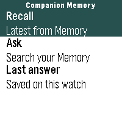

<!-- Generated by scripts/update_app_directory.py: do not edit by hand -->
[← All Pebble Developers](../developers.md)

# Companion Intelligence

*1 app · Last updated 2026-11-02 · [About these lists](../about-app-lists.md)*

Links: [Rebble App Store](https://apps.rebble.io/en_US/developer/6ae416c6db46610008a10892/1) · [GitHub (companionintelligence)](https://github.com/companionintelligence) · [Website (ci.computer)](https://ci.computer)

<h2 class="app-name" id="app-6ae4182fb99ed900093c95f4"><a href="https://apps.rebble.io/en_US/application/6ae4182fb99ed900093c95f4">Companion Memory</a> v1.0.0</h2>
<a class="app-source" href="https://github.com/companionintelligence/CI-Pebble" title="Source code" data-search-exclude>View source</a>

App · <a href="https://forum.rebble.io/t/1469" title="Discuss this app on the Rebble forum" data-search-exclude>Forum thread</a>

Other Released 2026-10-30 Updated 2026-10-30 Rebble App Store

Runs on: Round 2, Time 2, Pebble 2 Duo, Pebble 2, Time Round, Time, Classic

Companion Memory puts the Memory you host on your wrist. Recall: the latest from your Memory in one press. Ask: pick a question, or speak your own on watches with a microphone. Your Memory…

