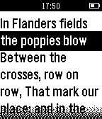

<!-- Generated by scripts/update_app_directory.py: do not edit by hand -->
[← All Pebble Developers](../developers.md)

# Connor Jewiss

*1 app · Last updated 2026-10-12 · [About these lists](../about-app-lists.md)*

Links: [Pebble App Store](https://apps.repebble.com/apps/dev/connor-jewiss_544b469dd68d8fe20a000045) · [GitHub (connorypebble)](https://github.com/connorypebble) · [Website (britishlegion.org.uk)](http://www.britishlegion.org.uk/make-a-donation)

<h2 class="app-name" id="app-545dea1211a9cda2c2000045"><a href="https://apps.repebble.com/545dea1211a9cda2c2000045">Flanders Field Poem</a> v1.1</h2>
<a class="app-source" href="https://github.com/connorypebble/Flanders-Field-Poem" title="Source code" data-search-exclude>View source</a>

App

Other Released 2014-11-08 Updated 2014-11-08

Runs on: Time 2, Pebble 2 Duo, Pebble 2, Time, Classic

This is the original Flanders Field poem reformed as a pebble watchapp especially for Remembrance Day and the Royal British Legion. Support the fallen! Use website link below! It is a plain text…

