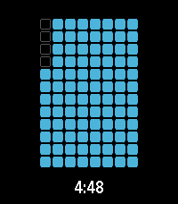

<!-- Generated by scripts/update_app_directory.py: do not edit by hand -->
[← All Pebble Developers](../developers.md)

# conor.code

*1 watchface and 1 app · Last updated 2026-10-12 · [About these lists](../about-app-lists.md)*

Links: [Rebble App Store](https://apps.rebble.io/en_US/developer/6948738999ff6900096081cd/1) · [Pebble App Store](https://apps.repebble.com/apps/dev/conor-code_dbb81f26ddb9f47c715d60b9) · [GitHub (chorankates)](https://github.com/chorankates)

<button type="button" data-filter="all" aria-pressed="true">All 2</button><button type="button" data-filter="watchface" aria-pressed="false">Watchfaces 1</button><button type="button" data-filter="watchapp" aria-pressed="false">Apps 1</button>

<label class="dev-sort">Sort by <select><option value="updated">Recently updated</option><option value="released">Newest release</option><option value="title">A–Z</option></select></label>

<h2 class="app-name" id="app-69581fbe39d92d0009bb746e"><a href="https://apps.rebble.io/en_US/application/69581fbe39d92d0009bb746e">covetous</a> v1.3</h2>
<a class="app-source" href="https://github.com/chorankates/covetous" title="Source code" data-search-exclude>View source</a>

Watchface · <a href="https://forum.rebble.io/t/421" title="Discuss this app on the Rebble forum" data-search-exclude>Forum thread</a>

No licence Released 2026-01-02 Updated 2026-01-06 Rebble App Store

Runs on: Round 2, Time 2, Pebble 2 Duo, Pebble 2, Time Round, Time, Classic

NOT WHAT IT WAS, trademark claim caused pulling

<h2 class="app-name" id="app-378bcb0a5fac43ca91e051d0"><a href="https://apps.repebble.com/378bcb0a5fac43ca91e051d0">ripple</a> v1.1</h2>
<a class="app-source" href="https://github.com/chorankates/ripple" title="Source code" data-search-exclude>View source</a>

App · <a href="https://forum.rebble.io/t/351" title="Discuss this app on the Rebble forum" data-search-exclude>Forum thread</a>

No licence Released 2025-12-24 Updated 2025-12-24

Runs on: Round 2, Time 2, Pebble 2 Duo, Pebble 2, Time Round, Time, Classic

a timer application with a number of visualization options

