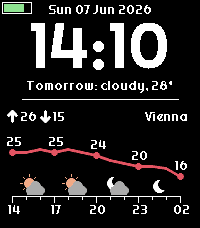

<!-- Generated by scripts/update_app_directory.py: do not edit by hand -->
[← All Pebble Developers](../developers.md)

# Constantin Matheis

*1 watchface · Last updated 2026-10-12 · [About these lists](../about-app-lists.md)*

Links: [Pebble App Store](https://apps.repebble.com/apps/dev/constantin-matheis_5c638b7cc2f9d5f32c07b725) · [GitHub (ConstantinMatheis)](https://github.com/ConstantinMatheis)

<h2 class="app-name" id="app-ec67f88d800e46b7bc65e873"><a href="https://apps.repebble.com/ec67f88d800e46b7bc65e873">Pebblecast Weather</a> v1.0.0</h2>
<a class="app-source" href="https://github.com/ConstantinMatheis/pebblecast-weather" title="Source code" data-search-exclude>View source</a>

Watchface

GPL-3.0 Released 2026-06-07 Updated 2026-06-07

Runs on: Time 2, Pebble 2 Duo, Pebble 2, Time, Classic

A watch face that visualizes the weather for the next 12 hours. Notable Features ------------------ - Light and dark themes - Celsius and Fahrenheit support - Short summary of tomorrow&#x27;s weather…

