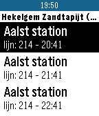

<!-- Generated by scripts/update_app_directory.py: do not edit by hand -->
[← All Pebble Developers](../developers.md)

# Coollision

*1 app · Last updated 2026-10-11 · [About these lists](../about-app-lists.md)*

Links: [Rebble App Store](https://apps.rebble.io/en_US/developer/5746fd980b20f032cf000010/1) · [GitHub (Coollision)](https://github.com/Coollision)

<h2 class="app-name" id="app-57d44296ffca49e6d100019b"><a href="https://apps.rebble.io/en_US/application/57d44296ffca49e6d100019b">De Lijn</a> v2</h2>
<a class="app-source" href="https://github.com/Coollision/PebbleAppDeLijn" title="Source code" data-search-exclude>View source</a>

App

No licence Released 2016-09-10 Updated 2017-01-19 Rebble App Store

Runs on: Round 2, Time 2, Pebble 2 Duo, Pebble 2, Time Round, Time, Classic

Kijk nu de real time tram of bus uren na van op je pols, geen nood meer om nog je gsm te nemen om te kijken hoe lang het nog duurt voor je bus er is. Een bushalte is makkelijk toe te voegen door…

