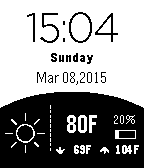

<!-- Generated by scripts/update_app_directory.py: do not edit by hand -->
[← All Pebble Developers](../developers.md)

# coolskies

*1 watchface · Last updated 2026-10-11 · [About these lists](../about-app-lists.md)*

Links: [Pebble App Store](https://apps.repebble.com/apps/dev/coolskies_54d911a405db7bc4c20000c0) · [GitHub (cchienhs)](https://github.com/cchienhs)

<h2 class="app-name" id="app-54fc3b8f2bf1bf614f000004"><a href="https://apps.repebble.com/54fc3b8f2bf1bf614f000004">Android Weather</a> v2.03</h2>
<a class="app-source" href="https://github.com/cchienhs/androidweather.git" title="Source code" data-search-exclude>View source</a>

Watchface

No licence Released 2015-03-08 Updated 2015-08-12

Runs on: Time 2, Pebble 2 Duo, Pebble 2, Time, Classic

WatchFace that emulates Android Weather Face. Used to be know as Android Weather F or Android Weather C. Have merged the two together since there is now a settings page.

