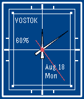
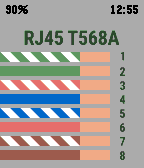

<!-- Generated by scripts/update_app_directory.py: do not edit by hand -->
[← All Pebble Developers](../developers.md)

# Corrivatus

*1 watchface and 1 app · Last updated 2026-10-11 · [About these lists](../about-app-lists.md)*

Links: [Pebble App Store](https://apps.repebble.com/apps/dev/corrivatus_567d7ff30bdc469402000225) · [Website (lambdacreate.com)](https://lambdacreate.com)

<button type="button" data-filter="all" aria-pressed="true">All 2</button><button type="button" data-filter="watchface" aria-pressed="false">Watchfaces 1</button><button type="button" data-filter="watchapp" aria-pressed="false">Apps 1</button>

<label class="dev-sort">Sort by <select><option value="updated">Recently updated</option><option value="released">Newest release</option><option value="title">A–Z</option></select></label>

<h2 class="app-name" id="app-68a345dbf4531c0009a7a393"><a href="https://apps.repebble.com/68a345dbf4531c0009a7a393">Vostok</a> v1.0</h2>
<a class="app-source" href="https://krei.lambdacreate.com/Pebble/Vostok" title="Source code" data-search-exclude>View source</a>

Watchface

Released 2025-08-18 Updated 2025-08-18

Runs on: Round 2, Time 2, Pebble 2 Duo, Pebble 2, Time Round, Time, Classic

A minimalist analog watch face inspired by the 1960&#x27;s era Vostok line of watches.

<h2 class="app-name" id="app-67cd0880d2acb302d5ba8218"><a href="https://apps.repebble.com/67cd0880d2acb302d5ba8218">Pinout</a> v1.0</h2>
<a class="app-source" href="https://krei.lambdacreate.com/durrendal/Pinout" title="Source code" data-search-exclude>View source</a>

App

Released 2025-03-09 Updated 2025-03-09

Runs on: Time 2, Time

Have you ever found yourself 30ft up a ladder tipping cables? Perhaps you just don&#x27;t remember which termination to make for an A side crossover cable? Wonder no longer, for you too can have these…

