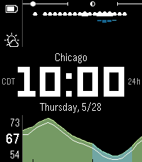

<!-- Generated by scripts/update_app_directory.py: do not edit by hand -->
[← All Pebble Developers](../developers.md)

# Cory Hughart

*1 watchface · Last updated 2026-10-11 · [About these lists](../about-app-lists.md)*

Links: [Pebble App Store](https://apps.repebble.com/apps/dev/cory-hughart_447f1d8a99b640fbc10d36ae) · [GitHub (cr0ybot)](https://github.com/cr0ybot) · [Website (cr0ybot.com)](https://cr0ybot.com/project/pebble-watchface-carbon/)

<h2 class="app-name" id="app-48b38a54db6d45cb85be6521"><a href="https://apps.repebble.com/48b38a54db6d45cb85be6521">Carbon</a> v1.5.0</h2>
<a class="app-source" href="https://github.com/cr0ybot/carbon" title="Source code" data-search-exclude>View source</a>

Watchface

Released 2026-05-08 Updated 2026-08-03

Runs on: Time 2, Pebble 2 Duo, Pebble 2, Time, Classic

A weather-focused, highly readable-at-a-glance Pebble watchface for the day ahead, with live weather via the free Open-Meteo API. Features: - The current time, of course, with a large…

