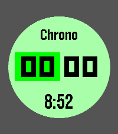

<!-- Generated by scripts/update_app_directory.py: do not edit by hand -->
[← All Pebble Developers](../developers.md)

# Cosmic Oscillator

*1 watchface and 1 app · Last updated 2026-10-12 · [About these lists](../about-app-lists.md)*

Links: [Pebble App Store](https://apps.repebble.com/apps/dev/cosmic-oscillator_8ace9a3153b33ec807dcd6c0) · [GitHub (tew42)](https://github.com/tew42)

<button type="button" data-filter="all" aria-pressed="true">All 2</button><button type="button" data-filter="watchface" aria-pressed="false">Watchfaces 1</button><button type="button" data-filter="watchapp" aria-pressed="false">Apps 1</button>

<label class="dev-sort">Sort by <select><option value="updated">Recently updated</option><option value="released">Newest release</option><option value="title">A–Z</option></select></label>

<h2 class="app-name" id="app-c0fb8a9ee65046f1a3f0c071"><a href="https://apps.repebble.com/c0fb8a9ee65046f1a3f0c071">Timer++</a> v1.2.1</h2>
<a class="app-source" href="https://github.com/tew42/pebble-timer-plus-plus" title="Source code" data-search-exclude>View source</a>

App

Released 2026-09-09 Updated 2026-09-15

Runs on: Round 2, Time 2, Pebble 2 Duo, Pebble 2, Time Round, Time, Classic

A beautiful, simple timer/stopwatch for the Pebble smartwatch, now with optimized battery life and more! Tell it how coarsely to show the time while it is a long way from zero, and it stops…

<h2 class="app-name" id="app-f810a004e5b14c04a0cfa07c"><a href="https://apps.repebble.com/f810a004e5b14c04a0cfa07c">Calligraphy (Minimal v2)</a> v0.1</h2>
<a class="app-source" href="https://github.com/tew42/pebble-calligraphy" title="Source code" data-search-exclude>View source</a>

Watchface

Released 2026-08-13 Updated 2026-08-13

Runs on: Round 2, Time 2

This watchface represents the hour and minute hands as a single continuous calligraphic stroke. Radial sections at both ends are joined by a dynamically shaped minimum-bending spline, with the…

