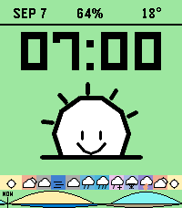

<!-- Generated by scripts/update_app_directory.py: do not edit by hand -->
[← All Pebble Developers](../developers.md)

# Cosmic Tinkerer 🚀

*1 watchface · Last updated 2026-10-12 · [About these lists](../about-app-lists.md)*

Links: [Pebble App Store](https://apps.repebble.com/apps/dev/cosmic-tinkerer_1602b6d66a7992941d2ab9cb) · [GitHub (romanimm)](https://github.com/romanimm)

<h2 class="app-name" id="app-6ab08b4fc3174945bc89d239"><a href="https://apps.repebble.com/6ab08b4fc3174945bc89d239">Happy Weather</a> v2.0.47</h2>
<a class="app-source" href="https://github.com/romanimm/happy1" title="Source code" data-search-exclude>View source</a>

Watchface

Released 2026-07-30 Updated 2026-10-04

Runs on: Round 2, Time 2

A little sunshine. A little attitude. Happy Weather gives your Pebble Time 2 a face to match the forecast. Choose Happy for cheerful weather characters or Angry for scowling suns and grumpy…

