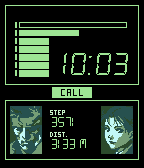

<!-- Generated by scripts/update_app_directory.py: do not edit by hand -->
[← All Pebble Developers](../developers.md)

# CosmicTacoCat

*2 watchfaces · Last updated 2026-10-11 · [About these lists](../about-app-lists.md)*

Links: [Pebble App Store](https://apps.repebble.com/apps/dev/cosmictacocat_5f6e8a1b51c0ff9f8ecc2504) · [GitHub (COZMIKDX)](https://github.com/COZMIKDX) · [GitHub (CosmicTacoCat)](https://github.com/CosmicTacoCat)

<button type="button" data-filter="all" aria-pressed="true">All 2</button><button type="button" data-filter="watchface" aria-pressed="false">Watchfaces 2</button><button type="button" data-filter="watchapp" aria-pressed="false" disabled>Apps 0</button>

<label class="dev-sort">Sort by <select><option value="updated">Recently updated</option><option value="released">Newest release</option><option value="title">A–Z</option></select></label>

<h2 class="app-name" id="app-637aa7cbc6c24a000a815ea4"><a href="https://apps.repebble.com/637aa7cbc6c24a000a815ea4">KemoPebble</a> v1.0</h2>
<a class="app-source" href="https://github.com/COZMIKDX/KemoPebble" title="Source code" data-search-exclude>View source</a>

Watchface

No licence Released 2022-11-20 Updated 2022-11-20

Runs on: Time 2, Time

A fluffy watchface. Still a work in progress. It will eventually change the animal displayed every hour. Currently only for Pebble Time. I&#x27;ll work on a monochrome version once this one is done.

<h2 class="app-name" id="app-5f6e8a1c51c0ff9f8ecc2506"><a href="https://apps.repebble.com/5f6e8a1c51c0ff9f8ecc2506">Metal Gear Solid</a> v1.0</h2>
<a class="app-source" href="https://github.com/CosmicTacoCat/MGS_Pebble" title="Source code" data-search-exclude>View source</a>

Watchface

No licence Released 2020-09-26 Updated 2020-09-26

Runs on: Time 2, Time

This is my Pebble Time version of preman_pasar&#x27;s Amazfit Metal Gear Solid watch face. The signal strength indicator is used to display the Pebble&#x27;s battery. Each increment represents approximately…

