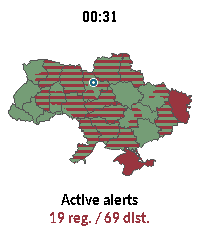

<!-- Generated by scripts/update_app_directory.py: do not edit by hand -->
[← All Pebble Developers](../developers.md)

# CrabbyDev

*1 app · Last updated 2026-10-11 · [About these lists](../about-app-lists.md)*

Links: [Pebble App Store](https://apps.repebble.com/apps/dev/crabbydev_350fc823f69da343c74a82ac) · [GitHub (LittleCrabby)](https://github.com/LittleCrabby)

<h2 class="app-name" id="app-90b69a2d24954ae184433c85"><a href="https://apps.repebble.com/90b69a2d24954ae184433c85">Ukraine Alerts</a> v1.0.0</h2>
<a class="app-source" href="https://github.com/LittleCrabby/pebble-ukraine-alerts" title="Source code" data-search-exclude>View source</a>

App

GPL-3.0 Released 2026-09-12 Updated 2026-09-12

Runs on: Round 2, Time 2

Ukraine Alerts brings real-time air raid alert monitoring and situational awareness directly to your Pebble smartwatch. Featuring an interactive vector map of Ukraine, the app tracks sirens across…

