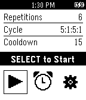

<!-- Generated by scripts/update_app_directory.py: do not edit by hand -->
[← All Pebble Developers](../developers.md)

# CRAE

*1 app · Last updated 2026-10-11 · [About these lists](../about-app-lists.md)*

Links: [Pebble App Store](https://apps.repebble.com/apps/dev/crae_52efa898593184556400004b) · [GitHub (craedev1)](https://github.com/craedev1)

<h2 class="app-name" id="app-54341c6f79b9e51d360001fa"><a href="https://apps.repebble.com/54341c6f79b9e51d360001fa">LiftSlow</a> v1.0</h2>
<a class="app-source" href="https://github.com/craedev1/LiftSlow" title="Source code" data-search-exclude>View source</a>

App

Released 2014-10-07 Updated 2014-10-22

Runs on: Time 2, Pebble 2 Duo, Pebble 2, Time, Classic

Struggling to break a plateau? Experiment with slow and deliberate weight lifting. The app features timing for slow up and down lift strokes, and variable rest, warmup and cool down intervals. The…

