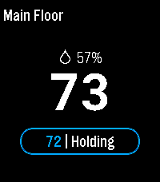

<!-- Generated by scripts/update_app_directory.py: do not edit by hand -->
[← All Pebble Developers](../developers.md)

# Craig Alexander

*2 apps · Last updated 2026-10-12 · [About these lists](../about-app-lists.md)*

Links: [Pebble App Store](https://apps.repebble.com/apps/dev/craig-alexander_532b717388718d52500004cc) · [GitHub (calexander3)](https://github.com/calexander3)

<button type="button" data-filter="all" aria-pressed="true">All 2</button><button type="button" data-filter="watchface" aria-pressed="false" disabled>Watchfaces 0</button><button type="button" data-filter="watchapp" aria-pressed="false">Apps 2</button>

<label class="dev-sort">Sort by <select><option value="updated">Recently updated</option><option value="released">Newest release</option><option value="title">A–Z</option></select></label>

<h2 class="app-name" id="app-56c3897cf3dab7ddce00001c"><a href="https://apps.repebble.com/56c3897cf3dab7ddce00001c">Hive for Ecobee</a> v2.0.2</h2>
<a class="app-source" href="https://github.com/calexander3/hive" title="Source code" data-search-exclude>View source</a>

App

No licence Released 2016-02-16 Updated 2026-07-14

Runs on: Round 2, Time 2, Pebble 2 Duo

Pebble smartwatch app that allows you to control ecobee ( www.ecobee.com ) thermostats.

<h2 class="app-name" id="app-561079d546914a9e6c00005a"><a href="https://apps.repebble.com/561079d546914a9e6c00005a">Marta Next Train</a> v2.0.1</h2>
<a class="app-source" href="https://github.com/calexander3/PebbleMartaTrainArrivals" title="Source code" data-search-exclude>View source</a>

App

No licence Released 2015-10-04 Updated 2026-06-28

Runs on: Round 2, Time 2, Pebble 2 Duo

Marta Next Train displays the arrival times of the upcoming trains in the metro Atlanta, Georgia area. *A connection to your phone is required for location and data services. Marta Next Train is…

