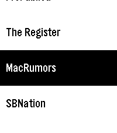
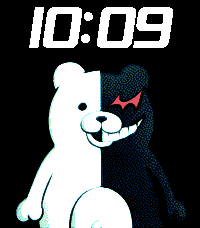

<!-- Generated by scripts/update_app_directory.py: do not edit by hand -->
[← All Pebble Developers](../developers.md)

# Cralex

*1 watchface and 1 app · Last updated 2026-11-23 · [About these lists](../about-app-lists.md)*

Links: [Pebble App Store](https://apps.repebble.com/apps/dev/cralex_58d573726ca387f0250002a3) · [GitHub (Cralex)](https://github.com/Cralex)

<button type="button" data-filter="all" aria-pressed="true">All 2</button><button type="button" data-filter="watchface" aria-pressed="false">Watchfaces 1</button><button type="button" data-filter="watchapp" aria-pressed="false">Apps 1</button>

<label class="dev-sort">Sort by <select><option value="updated">Recently updated</option><option value="released">Newest release</option><option value="title">A–Z</option></select></label>

<h2 class="app-name" id="app-6affee55566c710009ad4ca6"><a href="https://apps.repebble.com/6affee55566c710009ad4ca6">RSS Reader+</a> v3.0</h2>
<a class="app-source" href="https://github.com/Cralex/Pebble-RSS-Reader-Plus" title="Source code" data-search-exclude>View source</a>

App · <a href="https://forum.rebble.io/t/1529" title="Discuss this app on the Rebble forum" data-search-exclude>Forum thread</a>

GPL-3.0 Released 2026-11-20 Updated 2026-11-23

Runs on: Round 2, Time 2, Pebble 2 Duo, Pebble 2, Time Round, Time, Classic

RSS Reader+ is an AI ASSISTED fork of the excellent Pebble RSS Reader by Jonathan Alland, adding support for new watches, new features, and new stability. Read articles from the built-in feeds or…

<h2 class="app-name" id="app-29786bc154084192aaaae9a2"><a href="https://apps.repebble.com/29786bc154084192aaaae9a2">Monokuma Appears!</a> v1.0.0</h2>
<a class="app-source" href="https://github.com/Cralex/monokuma-appears-pebble" title="Source code" data-search-exclude>View source</a>

Watchface · <a href="https://forum.rebble.io/t/1543" title="Discuss this app on the Rebble forum" data-search-exclude>Forum thread</a>

No licence Released 2026-11-22 Updated 2026-11-22

Runs on: Round 2, Time 2, Pebble 2 Duo, Pebble 2, Time Round, Time, Classic

In celebration of the looming release of Danganronpa 2x2... MONOKUMA APPEARS! Every minute, one of the sixteen high school students- I mean adorable bear mascots hidden in the school will make an…

