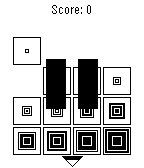

<!-- Generated by scripts/update_app_directory.py: do not edit by hand -->
[← All Pebble Developers](../developers.md)

# crazy2be

*1 app · Last updated 2026-10-11 · [About these lists](../about-app-lists.md)*

Links: [Pebble App Store](https://apps.repebble.com/apps/dev/crazy2be_528ae32fe71739b5cc000014) · [GitHub (crazy2be)](https://github.com/crazy2be)

<h2 class="app-name" id="app-5325c3d4ee3b27892f000493"><a href="https://apps.repebble.com/5325c3d4ee3b27892f000493">2048</a> v1.0.0</h2>
<a class="app-source" href="https://github.com/crazy2be/2048-pebble/" title="Source code" data-search-exclude>View source</a>

App

Released 2014-03-16 Updated 2014-03-16

Runs on: Time 2, Pebble 2 Duo, Pebble 2, Time, Classic

A clone of 2048 for the Pebble smartwatch. Tilt the screen to combine adjacent matching tiles. You win when you reach the 2048 tile! Press the middle button to pause/unpause. Press the back button…

