<!-- Generated by scripts/update_app_directory.py: do not edit by hand -->
[← All Pebble Developers](../developers.md)

# Creative Manaks

*15 watchfaces · Last updated 2026-10-11 · [About these lists](../about-app-lists.md)*

Links: [Pebble App Store](https://apps.repebble.com/apps/dev/creative-manaks_504fe850dc7e97a445b0a10d) · [GitHub (manaksu)](https://github.com/manaksu)

<button type="button" data-filter="all" aria-pressed="true">All 15</button><button type="button" data-filter="watchface" aria-pressed="false">Watchfaces 15</button><button type="button" data-filter="watchapp" aria-pressed="false" disabled>Apps 0</button>

<label class="dev-sort">Sort by <select><option value="updated">Recently updated</option><option value="released">Newest release</option><option value="title">A–Z</option></select></label>

<h2 class="app-name" id="app-284eba70698f4ed88a0b67f4"><a href="https://apps.repebble.com/284eba70698f4ed88a0b67f4">Tread Watch</a> v1.1.9</h2>
<a class="app-source" href="https://github.com/manaksu/Tread" title="Source code" data-search-exclude>View source</a>

Watchface

Released 2026-06-02 Updated 2026-06-03

Runs on: Time 2, Time

in progress

<a class="app-shot" href="https://apps.repebble.com/3ec735136ee54ed7b9cf4de6" data-search-exclude>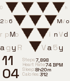</a>

<h2 class="app-name" id="app-3ec735136ee54ed7b9cf4de6"><a href="https://apps.repebble.com/3ec735136ee54ed7b9cf4de6">PyramidWatch</a> v2.0</h2>
<a class="app-source" href="https://github.com/manaksu/Pyramid" title="Source code" data-search-exclude>View source</a>

Watchface

Released 2026-05-30 Updated 2026-05-31

Runs on: Time 2, Time

new

<a class="app-shot" href="https://apps.repebble.com/bff9181191da49d992568e39" data-search-exclude>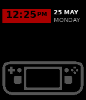</a>

<h2 class="app-name" id="app-bff9181191da49d992568e39"><a href="https://apps.repebble.com/bff9181191da49d992568e39">Valve Watchface</a> v1.70</h2>
<a class="app-source" href="https://github.com/manaksu/ValveWatch" title="Source code" data-search-exclude>View source</a>

Watchface

Released 2026-05-25 Updated 2026-05-30

Runs on: Time 2, Time

A fan-made watchface dedicated to Valve Corporation and the Steam Deck — because great design deserves to live on your wrist too. Time is displayed in bold inside a signature red rectangle, a…

<h2 class="app-name" id="app-3e32f62748b84166aec7f5ae"><a href="https://apps.repebble.com/3e32f62748b84166aec7f5ae">TypeWriter Watch</a> v1.40</h2>
<a class="app-source" href="https://github.com/manaksu/TypewriterWatch" title="Source code" data-search-exclude>View source</a>

Watchface

Released 2026-05-17 Updated 2026-05-30

Runs on: Time 2, Time

A typewriter on your wrist. Paper grain texture, Special Elite font, and the satisfying clack of old-school letterpress — your day, time, city and date typed out exactly as it should be.

<a class="app-shot" href="https://apps.repebble.com/4301ead109fe41f5b73ef4a0" data-search-exclude>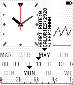</a>

<h2 class="app-name" id="app-4301ead109fe41f5b73ef4a0"><a href="https://apps.repebble.com/4301ead109fe41f5b73ef4a0">Rect Watch</a> v3.0</h2>
<a class="app-source" href="https://github.com/manaksu/rectwatch" title="Source code" data-search-exclude>View source</a>

Watchface

Released 2026-05-11 Updated 2026-05-30

Runs on: Time 2, Pebble 2 Duo, Pebble 2, Time

RectWatch A clean, minimal analog watchface for Pebble Time Steel. Built around a precise rectangular clock face with a cream e-paper texture, RectWatch pairs classic watchmaking with modern data…

<a class="app-shot" href="https://apps.repebble.com/bc1aca03d4f74a079f0b039a" data-search-exclude>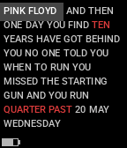</a>

<h2 class="app-name" id="app-bc1aca03d4f74a079f0b039a"><a href="https://apps.repebble.com/bc1aca03d4f74a079f0b039a">Pink Floyd Watch</a> v1.90</h2>
<a class="app-source" href="https://github.com/manaksu/PinkFloyd" title="Source code" data-search-exclude>View source</a>

Watchface

Released 2026-05-20 Updated 2026-05-30

Runs on: Time 2, Pebble 2 Duo, Pebble 2, Time

&quot;And then one day you find, ten years have got behind you.&quot; Time told through the words of Pink Floyd. Every minute, a lyric from the catalogue fills your screen — and somewhere in those words…

<h2 class="app-name" id="app-7eb74e91c4a1462782a203ff"><a href="https://apps.repebble.com/7eb74e91c4a1462782a203ff">Mosaic</a> v1.50</h2>
<a class="app-source" href="https://github.com/manaksu/Vangogh" title="Source code" data-search-exclude>View source</a>

Watchface

Released 2026-05-22 Updated 2026-05-30

Runs on: Time 2, Pebble 2 Duo, Pebble 2, Time

Van Gogh Watch

<a class="app-shot" href="https://apps.repebble.com/c0b16641ab934e11b3e57751" data-search-exclude>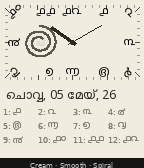</a>

<h2 class="app-name" id="app-c0b16641ab934e11b3e57751"><a href="https://apps.repebble.com/c0b16641ab934e11b3e57751">Malayalam Clock</a> v4.10</h2>
<a class="app-source" href="https://github.com/manaksu/MalayalamWatch" title="Source code" data-search-exclude>View source</a>

Watchface

Released 2026-05-05 Updated 2026-05-30

Runs on: Time 2, Pebble 2 Duo, Pebble 2, Time

Malayalam Clock brings the Malayalam script to your Pebble Time Steel — twelve hand-rendered Malayalam numerals arranged around a clean, cream analog clock face, with Kerala&#x27;s formation date…

<h2 class="app-name" id="app-8ddf0a68bd2a4251b4eab414"><a href="https://apps.repebble.com/8ddf0a68bd2a4251b4eab414">Lofi Watch</a> v1.80</h2>
<a class="app-source" href="https://github.com/manaksu/cozy-day" title="Source code" data-search-exclude>View source</a>

Watchface

Released 2026-05-09 Updated 2026-05-30

Runs on: Time 2, Pebble 2 Duo, Pebble 2, Time

New App

<a class="app-shot" href="https://apps.repebble.com/a50e74e276f04309ae80f0d3" data-search-exclude>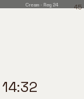</a>

<h2 class="app-name" id="app-a50e74e276f04309ae80f0d3"><a href="https://apps.repebble.com/a50e74e276f04309ae80f0d3">InkCorner Watch</a> v1.35</h2>
<a class="app-source" href="https://github.com/manaksu/ink-corner" title="Source code" data-search-exclude>View source</a>

Watchface

Released 2026-05-30 Updated 2026-05-30

Runs on: Time 2, Pebble 2 Duo, Pebble 2, Time

In progress

<a class="app-shot" href="https://apps.repebble.com/da97e8d3d4a3400c87379cde" data-search-exclude>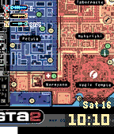</a>

<h2 class="app-name" id="app-da97e8d3d4a3400c87379cde"><a href="https://apps.repebble.com/da97e8d3d4a3400c87379cde">Game Watch</a> v1.50</h2>
<a class="app-source" href="https://github.com/manaksu/GTA-2Watch" title="Source code" data-search-exclude>View source</a>

Watchface

Released 2026-05-17 Updated 2026-05-30

Runs on: Time 2, Time

Inspired by GTA2 Your Pebble Time is now running the GTA2 Industrial Sector. The iconic map fills the screen, authentic HUD bars track your steps, heart rate and battery — just like in-game…

<a class="app-shot" href="https://apps.repebble.com/c4baaf223a4542c5b985d048" data-search-exclude>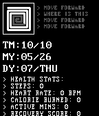</a>

<h2 class="app-name" id="app-c4baaf223a4542c5b985d048"><a href="https://apps.repebble.com/c4baaf223a4542c5b985d048">DOS VGA</a> v1.90</h2>
<a class="app-source" href="https://github.com/manaksu/DOS-VGA" title="Source code" data-search-exclude>View source</a>

Watchface

Released 2026-05-07 Updated 2026-05-30

Runs on: Time 2, Pebble 2 Duo, Pebble 2, Time

DOS-RPG Your wrist just rolled a NAT 20 on style. Forget clean. Forget minimal. This is your health data rendered in the glow of a CRT monitor, parsed through a dungeon crawler terminal, and…

<a class="app-shot" href="https://apps.repebble.com/888dd564643647808da7d859" data-search-exclude>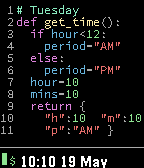</a>

<h2 class="app-name" id="app-888dd564643647808da7d859"><a href="https://apps.repebble.com/888dd564643647808da7d859">Code Watch</a> v1.20</h2>
<a class="app-source" href="https://github.com/manaksu/CodeWatch" title="Source code" data-search-exclude>View source</a>

Watchface

Released 2026-05-19 Updated 2026-05-30

Runs on: Time 2, Time

Time as code. The watch displays the current time as a Python function — syntax-highlighted in VS Code colours, with JetBrains Mono font. Every minute, the code updates. Read the return value to…

<a class="app-shot" href="https://apps.repebble.com/458f35557f90489f8a0967ce" data-search-exclude>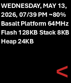</a>

<h2 class="app-name" id="app-458f35557f90489f8a0967ce"><a href="https://apps.repebble.com/458f35557f90489f8a0967ce">Aptos Watch</a> v1.0.7</h2>
<a class="app-source" href="https://github.com/manaksu/Aptos-Watch" title="Source code" data-search-exclude>View source</a>

Watchface

Released 2026-05-14 Updated 2026-05-30

Runs on: Time 2, Pebble 2 Duo, Pebble 2, Time

new

<a class="app-shot" href="https://apps.repebble.com/27712bf7eb5f44a1b56a4204" data-search-exclude>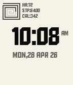</a>

<h2 class="app-name" id="app-27712bf7eb5f44a1b56a4204"><a href="https://apps.repebble.com/27712bf7eb5f44a1b56a4204">Aldo Watch</a> v4.20</h2>
<a class="app-source" href="https://github.com/manaksu/AldoWatch" title="Source code" data-search-exclude>View source</a>

Watchface

Released 2026-04-29 Updated 2026-05-30

Runs on: Time 2, Pebble 2 Duo, Pebble 2, Time

Aldo Clean and typographic. Built around the bold geometric character of the Aldo the Apache font, this watchface keeps it minimal — time front and center on a creamy white canvas, with a subtle…

