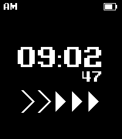

<!-- Generated by scripts/update_app_directory.py: do not edit by hand -->
[← All Pebble Developers](../developers.md)

# crims0n

*1 watchface · Last updated 2026-10-11 · [About these lists](../about-app-lists.md)*

Links: [Rebble App Store](https://apps.rebble.io/en_US/developer/68f926c8b2e4450009362a34/1) · [GitHub (crims0n)](https://github.com/crims0n) · [Website (x.com)](https://x.com/crims0n)

<h2 class="app-name" id="app-6a9ac7065266090009437eac"><a href="https://apps.rebble.io/en_US/application/6a9ac7065266090009437eac">Digivice Watchface</a> v1.0</h2>
<a class="app-source" href="https://github.com/crims0n/digivice-watchface" title="Source code" data-search-exclude>View source</a>

Watchface · <a href="https://forum.rebble.io/t/1324" title="Discuss this app on the Rebble forum" data-search-exclude>Forum thread</a>

Released 2026-09-04 Updated 2026-09-04 Rebble App Store

Runs on: Round 2, Time 2, Pebble 2 Duo, Pebble 2, Time Round, Time, Classic

A clean, retro watchface inspired by the classic Digimon Digivice virtual pet! Features: • Classic pixel-styled digital clock with persistent AM / PM indicator. • 5 animated chevron arrows…

