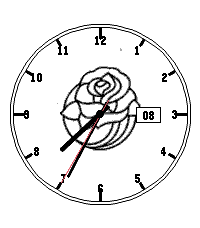

<!-- Generated by scripts/update_app_directory.py: do not edit by hand -->
[← All Pebble Developers](../developers.md)

# Cronin Technology

*1 watchface · Last updated 2026-10-12 · [About these lists](../about-app-lists.md)*

Links: [Pebble App Store](https://apps.repebble.com/apps/dev/cronin-technology_696e0fa985a6359578c5e48d) · [GitHub (jon-rebirtharmitage)](https://github.com/jon-rebirtharmitage)

<h2 class="app-name" id="app-b895216511fd47a5ba59c147"><a href="https://apps.repebble.com/b895216511fd47a5ba59c147">Hawkeye Rosebowl</a> v1.0.0</h2>
<a class="app-source" href="https://github.com/jon-rebirtharmitage/pebble_rosebowl" title="Source code" data-search-exclude>View source</a>

Watchface

Released 2026-05-09 Updated 2026-05-09

Runs on: Round 2, Time 2

Hawkeye Rosebowl for my battle brother

