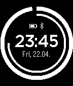

<!-- Generated by scripts/update_app_directory.py: do not edit by hand -->
[← All Pebble Developers](../developers.md)

# cS

*2 watchfaces · Last updated 2026-10-11 · [About these lists](../about-app-lists.md)*

Links: [Pebble App Store](https://apps.repebble.com/apps/dev/cs_5453716ff44f6aceb9000061) · [GitHub (chms)](https://github.com/chms) · [Website (blog.chschmid.com)](http://blog.chschmid.com/?p=1873)

<button type="button" data-filter="all" aria-pressed="true">All 2</button><button type="button" data-filter="watchface" aria-pressed="false">Watchfaces 2</button><button type="button" data-filter="watchapp" aria-pressed="false" disabled>Apps 0</button>

<label class="dev-sort">Sort by <select><option value="updated">Recently updated</option><option value="released">Newest release</option><option value="title">A–Z</option></select></label>

<h2 class="app-name" id="app-54fb92804720a88f330000a6"><a href="https://apps.repebble.com/54fb92804720a88f330000a6">ArcS+</a> v1.2</h2>
<a class="app-source" href="https://github.com/chms/ArcS" title="Source code" data-search-exclude>View source</a>

Watchface

Released 2015-03-08 Updated 2015-03-08

Runs on: Time 2, Pebble 2 Duo, Pebble 2, Time, Classic

ArcS+ uses arcs to illustrate how time flies. At the same time it features a digital clock, the date, the weekday and indicators for your battery and the bluetooth connection to your phone.

<h2 class="app-name" id="app-54f245bd0bea20aa090000ce"><a href="https://apps.repebble.com/54f245bd0bea20aa090000ce">ArcS</a> v1.1</h2>
<a class="app-source" href="https://github.com/chms/ArcS" title="Source code" data-search-exclude>View source</a>

Watchface

Released 2015-02-28 Updated 2015-03-05

Runs on: Time 2, Pebble 2 Duo, Pebble 2, Time, Classic

Yet another watchface that uses arcs to illustrate how time flies.

