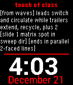
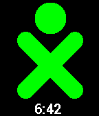

<!-- Generated by scripts/update_app_directory.py: do not edit by hand -->
[← All Pebble Developers](../developers.md)

# cscott

*3 watchfaces · Last updated 2026-10-12 · [About these lists](../about-app-lists.md)*

Links: [Pebble App Store](https://apps.repebble.com/apps/dev/cscott_53b76b01d773ce09420000e4) · [GitHub (cscott)](https://github.com/cscott)

<button type="button" data-filter="all" aria-pressed="true">All 3</button><button type="button" data-filter="watchface" aria-pressed="false">Watchfaces 3</button><button type="button" data-filter="watchapp" aria-pressed="false" disabled>Apps 0</button>

<label class="dev-sort">Sort by <select><option value="updated">Recently updated</option><option value="released">Newest release</option><option value="title">A–Z</option></select></label>

<h2 class="app-name" id="app-549739eb3b132dedb500011c"><a href="https://apps.repebble.com/549739eb3b132dedb500011c">Square Dance C4 Flash Cards</a> v1.4</h2>
<a class="app-source" href="https://github.com/cscott/pebble-c4" title="Source code" data-search-exclude>View source</a>

Watchface

No licence Released 2014-12-21 Updated 2021-08-01

Runs on: Time 2, Pebble 2 Duo, Pebble 2, Time, Classic

A pebble watchface which displays flashcards for square dance calls at the C4 level.

<h2 class="app-name" id="app-5497633d83524456ec000039"><a href="https://apps.repebble.com/5497633d83524456ec000039">XO</a> v1.2</h2>
<a class="app-source" href="https://github.com/cscott/pebble-xo" title="Source code" data-search-exclude>View source</a>

Watchface

No licence Released 2014-12-22 Updated 2015-06-24

Runs on: Time 2, Pebble 2 Duo, Pebble 2, Time, Classic

A simple watchface displaying the One Laptop per Child/Sugar &quot;XO man&quot;.

<h2 class="app-name" id="app-54974cada8c1257044000023"><a href="https://apps.repebble.com/54974cada8c1257044000023">Nix</a> v1.3</h2>
<a class="app-source" href="https://github.com/cscott/pebble-nix" title="Source code" data-search-exclude>View source</a>

Watchface

No licence Released 2014-12-21 Updated 2015-06-24

Runs on: Time 2, Pebble 2 Duo, Pebble 2, Time, Classic

A &quot;nix&quot; style watchface for pebble. The number of filled squares in each group gives the digits in the current time. Hours are at the top. The pattern of filled squares changes every three seconds.

