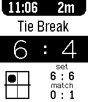

<!-- Generated by scripts/update_app_directory.py: do not edit by hand -->
[← All Pebble Developers](../developers.md)

# cstrat

*1 app · Last updated 2026-10-11 · [About these lists](../about-app-lists.md)*

Links: [Pebble App Store](https://apps.repebble.com/apps/dev/cstrat_52a6d3e36ce7d5639f000019) · [GitHub (cstrat)](https://github.com/cstrat)

<h2 class="app-name" id="app-52d23589c44c048e1d00002a"><a href="https://apps.repebble.com/52d23589c44c048e1d00002a">Tennis Pro</a> v1.0.1</h2>
<a class="app-source" href="https://github.com/cstrat/tennis-pro.git" title="Source code" data-search-exclude>View source</a>

App

Released 2014-01-12 Updated 2014-01-30

Runs on: Time 2, Pebble 2 Duo, Pebble 2, Time, Classic

Keep track of your tennis match with ease, for free! - Highly configurable - Config and game data saves locally - Allows for multiple game lengths - Tiebreak/NoAd/ProScore modes - Serve tracking …

