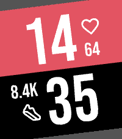

<!-- Generated by scripts/update_app_directory.py: do not edit by hand -->
[← All Pebble Developers](../developers.md)

# cvuorinen

*1 watchface · Last updated 2026-10-11 · [About these lists](../about-app-lists.md)*

Links: [Pebble App Store](https://apps.repebble.com/apps/dev/cvuorinen_e8e19b6fde1bd99a69e5c271) · [GitHub (cvuorinen)](https://github.com/cvuorinen)

<h2 class="app-name" id="app-fe490689d3a84fe49f1cbb10"><a href="https://apps.repebble.com/fe490689d3a84fe49f1cbb10">Faceoff Remix</a> v1.1.0</h2>
<a class="app-source" href="https://github.com/cvuorinen/pebble-faceoff" title="Source code" data-search-exclude>View source</a>

Watchface · <a href="https://forum.rebble.io/t/1352" title="Discuss this app on the Rebble forum" data-search-exclude>Forum thread</a>

Released 2026-09-13 Updated 2026-09-14

Runs on: Round 2, Time 2, Pebble 2 Duo, Pebble 2, Time Round, Time, Classic

A Pebble watchface that is a &quot;Remix&quot; of a watchface called &quot;Faceoff&quot; (inspired by &quot;versus&quot; screens) made by ollien. Credits to ollien for the original idea, and for releasing it as open source…

