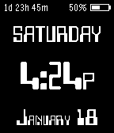

<!-- Generated by scripts/update_app_directory.py: do not edit by hand -->
[← All Pebble Developers](../developers.md)

# CYANware Software Solutions

*1 watchface · Last updated 2026-10-11 · [About these lists](../about-app-lists.md)*

Links: [Pebble App Store](https://apps.repebble.com/apps/dev/cyanware-software-solutions_529b84bad17b50324600003f)

<h2 class="app-name" id="app-529b89f7d17b50ed2b000047"><a href="https://apps.repebble.com/529b89f7d17b50ed2b000047">cyborg</a> v2.1.2</h2>
<a class="app-source" href="https://bitbucket.org/cyanware/pebble-watch-faces" title="Source code" data-search-exclude>View source</a>

Watchface

Released 2013-12-01 Updated 2014-01-27

Runs on: Time 2, Pebble 2 Duo, Pebble 2, Time, Classic

Simple watchface, showing the weekday, month and date. Supports 12hr/24hr. Maximizes the Pebble&#x27;s battery life by displaying a power-saving &quot;Screen Saver&quot; mode that displays a static image between…

