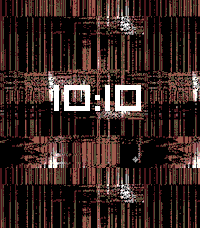
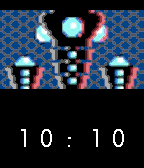

<!-- Generated by scripts/update_app_directory.py: do not edit by hand -->
[← All Pebble Developers](../developers.md)

# dabar

*2 watchfaces · Last updated 2026-10-12 · [About these lists](../about-app-lists.md)*

Links: [Pebble App Store](https://apps.repebble.com/apps/dev/dabar_cd6ddba9be954fba9d2f3592) · [GitHub (david-barrett)](https://github.com/david-barrett)

<button type="button" data-filter="all" aria-pressed="true">All 2</button><button type="button" data-filter="watchface" aria-pressed="false">Watchfaces 2</button><button type="button" data-filter="watchapp" aria-pressed="false" disabled>Apps 0</button>

<label class="dev-sort">Sort by <select><option value="updated">Recently updated</option><option value="released">Newest release</option><option value="title">A–Z</option></select></label>

<h2 class="app-name" id="app-4a193890e40f406b8c5172a7"><a href="https://apps.repebble.com/4a193890e40f406b8c5172a7">Glitch</a> v1.2</h2>
<a class="app-source" href="https://github.com/david-barrett/pebble_glitch" title="Source code" data-search-exclude>View source</a>

Watchface

No licence Released 2026-04-14 Updated 2026-04-14

Runs on: Round 2, Time 2, Time Round, Time

Glitching watchface

<h2 class="app-name" id="app-c8134a4e1ea84e7293abb0e6"><a href="https://apps.repebble.com/c8134a4e1ea84e7293abb0e6">UQM_Pilot_Face</a> v1.1</h2>
<a class="app-source" href="https://github.com/david-barrett/pebble_uqm_watchface" title="Source code" data-search-exclude>View source</a>

Watchface

No licence Released 2026-04-10 Updated 2026-04-10

Runs on: Round 2, Time 2, Pebble 2 Duo, Pebble 2, Time Round, Time, Classic

Watchface showing pilots from the Ur Quan Masters Pilot image changes every minute

