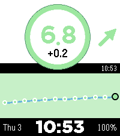
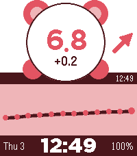

<!-- Generated by scripts/update_app_directory.py: do not edit by hand -->
[← All Pebble Developers](../developers.md)

# dabear

*2 watchfaces · Last updated 2026-10-12 · [About these lists](../about-app-lists.md)*

Links: [Pebble App Store](https://apps.repebble.com/apps/dev/unknown_6e1072e4037ce66aa33da174) · [GitHub (dabear)](https://github.com/dabear)

<button type="button" data-filter="all" aria-pressed="true">All 2</button><button type="button" data-filter="watchface" aria-pressed="false">Watchfaces 2</button><button type="button" data-filter="watchapp" aria-pressed="false" disabled>Apps 0</button>

<label class="dev-sort">Sort by <select><option value="updated">Recently updated</option><option value="released">Newest release</option><option value="title">A–Z</option></select></label>

<h2 class="app-name" id="app-d47105a3c7c1489895b067ff"><a href="https://apps.repebble.com/d47105a3c7c1489895b067ff">Luped CGM</a> v0.1.1</h2>
<a class="app-source" href="https://github.com/dabear/CrimsonBearPebbleWatchFace" title="Source code" data-search-exclude>View source</a>

Watchface

MIT Released 2026-10-12 Updated 2026-10-12

Runs on: Round 2, Time 2

A Loop-styled CGM watchface for Pebble Time 2 and Pebble Round 2. Requires a direct watch connection from a supported iPhone app such as Loop or Trio; the watchface has no Pebble app settings and…

<h2 class="app-name" id="app-ebc3f63147e6481599da4b8e"><a href="https://apps.repebble.com/ebc3f63147e6481599da4b8e">CrimsonBear Cgm</a> v2.2.19</h2>
<a class="app-source" href="https://github.com/dabear/CrimsonBearPebbleWatchFace" title="Source code" data-search-exclude>View source</a>

Watchface

MIT Released 2026-08-24 Updated 2026-09-08

Runs on: Round 2, Time 2

A bear-themed Nightscout CGM watchface for Pebble Time 2 and Pebble Round 2, with mg/dL and mmol/L support, configurable thresholds, trend data, battery status, and an optional full-screen glucose…

