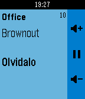

<!-- Generated by scripts/update_app_directory.py: do not edit by hand -->
[← All Pebble Developers](../developers.md)

# daduke

*1 app · Last updated 2026-10-11 · [About these lists](../about-app-lists.md)*

Links: [Pebble App Store](https://apps.repebble.com/apps/dev/daduke_56490a754f9b2993b0000011) · [GitHub (daduke)](https://github.com/daduke)

<h2 class="app-name" id="app-565c94c0eae744b790000068"><a href="https://apps.repebble.com/565c94c0eae744b790000068">LMS Controller</a> v2.61</h2>
<a class="app-source" href="https://github.com/daduke/LMSController" title="Source code" data-search-exclude>View source</a>

App

Released 2015-11-30 Updated 2019-07-24

Runs on: Round 2, Time 2, Pebble 2 Duo, Pebble 2, Time Round, Time, Classic

Control your Logitech Media Server (aka LMS or Squeezebox) via Pebble. new feature: long press select in track info screen enters the music menu! Buttons (up / select / down): player menu: * short…

