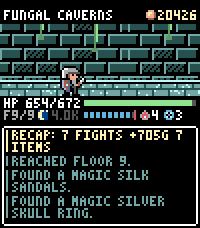

<!-- Generated by scripts/update_app_directory.py: do not edit by hand -->
[← All Pebble Developers](../developers.md)

# daipoyo

*1 app · Last updated 2026-10-11 · [About these lists](../about-app-lists.md)*

Links: [Pebble App Store](https://apps.repebble.com/apps/dev/daipoyo_af992eff386264ca6a6e17bb) · [GitHub (daipoyo)](https://github.com/daipoyo)

<h2 class="app-name" id="app-38d23789644c43558635081a"><a href="https://apps.repebble.com/38d23789644c43558635081a">Idle Dungeon</a> v1.0.3</h2>
<a class="app-source" href="https://github.com/daipoyo/idle_dungeon" title="Source code" data-search-exclude>View source</a>

App

Released 2026-09-22 Updated 2026-09-22

Runs on: Time 2

Idle Dungeon turns the steps you take during the day into a dungeon crawl. Pick a dungeon in the morning and go about your day. Every step carries the hero deeper: monsters, traps, fountains and…

