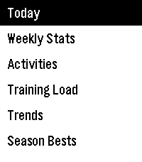
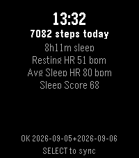
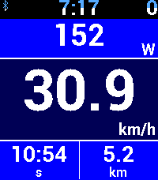
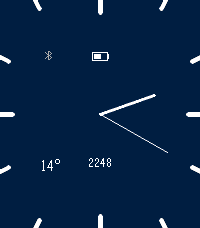
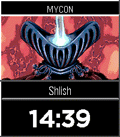
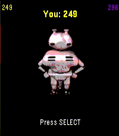
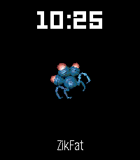
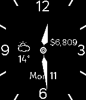

<!-- Generated by scripts/update_app_directory.py: do not edit by hand -->
[← All Pebble Developers](../developers.md)

# Daktak

*5 watchfaces and 4 apps · Last updated 2026-10-11 · [About these lists](../about-app-lists.md)*

Links: [Rebble App Store](https://apps.rebble.io/en_US/developer/56e681d026fa04b2d900006c/1) · [GitHub (daktak)](https://github.com/daktak) · [GitLab (daktak)](https://gitlab.com/daktak)

<button type="button" data-filter="all" aria-pressed="true">All 9</button><button type="button" data-filter="watchface" aria-pressed="false">Watchfaces 5</button><button type="button" data-filter="watchapp" aria-pressed="false">Apps 4</button>

<label class="dev-sort">Sort by <select><option value="updated">Recently updated</option><option value="released">Newest release</option><option value="title">A–Z</option></select></label>

<h2 class="app-name" id="app-6a813cce06c3a00009b85c96"><a href="https://apps.rebble.io/en_US/application/6a813cce06c3a00009b85c96">Intervals.icu</a> v0.6.0</h2>
<a class="app-source" href="https://github.com/daktak/pebble_intervals_icu" title="Source code" data-search-exclude>View source</a>

App · <a href="https://forum.rebble.io/t/1240" title="Discuss this app on the Rebble forum" data-search-exclude>Forum thread</a>

Released 2026-08-16 Updated 2026-10-02 Rebble App Store

Runs on: Time 2, Pebble 2 Duo, Pebble 2, Time

Unofficial Intervals.icu app View the weeks activities and summary View your fitness/form graph

<h2 class="app-name" id="app-6a9cbfd2d5f13e000a813cca"><a href="https://apps.rebble.io/en_US/application/6a9cbfd2d5f13e000a813cca">Intervals Wellness Sync</a> v1.5.0</h2>
<a class="app-source" href="https://github.com/daktak/pebble-intervals-wellness" title="Source code" data-search-exclude>View source</a>

App · <a href="https://forum.rebble.io/t/1335" title="Discuss this app on the Rebble forum" data-search-exclude>Forum thread</a>

Released 2026-09-06 Updated 2026-09-24 Rebble App Store

Runs on: Round 2, Time 2, Pebble 2 Duo, Pebble 2, Time Round, Time

Push sleep, hr and step data to intervals.icu For HRV, enable in background apps (Pebble Time 2)

<h2 class="app-name" id="app-6a8533eb6b779600084ed8e1"><a href="https://apps.rebble.io/en_US/application/6a8533eb6b779600084ed8e1">KayPS</a> v26.9.1</h2>
<a class="app-source" href="https://github.com/daktak/JayPS-WatchFace" title="Source code" data-search-exclude>View source</a>

App · <a href="https://forum.rebble.io/t/1267" title="Discuss this app on the Rebble forum" data-search-exclude>Forum thread</a>

Released 2026-08-19 Updated 2026-09-08 Rebble App Store

Runs on: Round 2, Time 2, Pebble 2 Duo, Pebble 2, Time Round, Time, Classic

Android app required. https://github.com/daktak/JayPS-AndroidApp (formerly known as Pebble Bike/Ventoo/JayPS) KayPS is a GPS sports tracker for your Pebble. It uses your phone&#x27;s GPS to send speed…

<h2 class="app-name" id="app-5b2dc5defbaf9aba1f0004bb"><a href="https://apps.rebble.io/en_US/application/5b2dc5defbaf9aba1f0004bb">Colour Analog</a> v1.2.0</h2>
<a class="app-source" href="https://gitlab.com/daktak/ColourAnalog" title="Source code" data-search-exclude>View source</a>

Watchface · <a href="https://forum.rebble.io/t/1042" title="Discuss this app on the Rebble forum" data-search-exclude>Forum thread</a>

Released 2018-06-23 Updated 2026-08-18 Rebble App Store

Runs on: Round 2, Time 2, Pebble 2 Duo, Pebble 2, Time Round, Time, Classic

Simple Pebble Watchface Complications: * Battery * Bluetooth * Phone battery * Time * Date * Weather temperature * Health stats * CoinMarketCap crypto price * URL string fetch

<h2 class="app-name" id="app-6a7686ad1772b200090ffb34"><a href="https://apps.rebble.io/en_US/application/6a7686ad1772b200090ffb34">UQM Pilot Watchface</a> v1.1.0</h2>
<a class="app-source" href="https://github.com/daktak/pebble_uqm_pilot_face" title="Source code" data-search-exclude>View source</a>

Watchface · <a href="https://forum.rebble.io/t/1218" title="Discuss this app on the Rebble forum" data-search-exclude>Forum thread</a>

Released 2026-08-08 Updated 2026-08-08 Rebble App Store

Runs on: Time 2, Pebble 2 Duo, Pebble 2, Time, Classic

Watchface showing pilots from the Ur Quan Masters along with the pilots name. Configurable

<h2 class="app-name" id="app-6a485d66b6d159000952a982"><a href="https://apps.rebble.io/en_US/application/6a485d66b6d159000952a982">Paradroid Takeover</a> v0.3.0</h2>
<a class="app-source" href="https://github.com/daktak/pebble_paradroid_takeover" title="Source code" data-search-exclude>View source</a>

App · <a href="https://forum.rebble.io/t/1117" title="Discuss this app on the Rebble forum" data-search-exclude>Forum thread</a>

Released 2026-07-04 Updated 2026-07-08 Rebble App Store

Runs on: Time 2, Time

Takeover droids to reach Captain

<h2 class="app-name" id="app-5b01f9eaf385887700000bc2"><a href="https://apps.rebble.io/en_US/application/5b01f9eaf385887700000bc2">UQM Watchface</a> v1.2.0</h2>
<a class="app-source" href="https://github.com/daktak/pebble_uqm_watchface" title="Source code" data-search-exclude>View source</a>

Watchface · <a href="https://forum.rebble.io/t/1044" title="Discuss this app on the Rebble forum" data-search-exclude>Forum thread</a>

Released 2018-05-20 Updated 2026-06-15 Rebble App Store

Runs on: Round 2, Time 2, Pebble 2 Duo, Pebble 2, Time Round, Time, Classic

Ships from The Ur-Quan Masters as second, minute or hour hand. http://sc2.sourceforge.net/

<h2 class="app-name" id="app-6a2fbc2f72de6e00088d251b"><a href="https://apps.rebble.io/en_US/application/6a2fbc2f72de6e00088d251b">Paradroid Watchface</a> v1.0.0</h2>
<a class="app-source" href="https://github.com/daktak/pebble_paradroid_2000_watchface" title="Source code" data-search-exclude>View source</a>

Watchface · <a href="https://forum.rebble.io/t/1061" title="Discuss this app on the Rebble forum" data-search-exclude>Forum thread</a>

Released 2026-06-15 Updated 2026-06-15 Rebble App Store

Runs on: Time 2, Pebble 2 Duo, Pebble 2, Time, Classic

Display Paradroid bots Images from https://www.freedroid.org/

<h2 class="app-name" id="app-62ecee85e595b3000a939a36"><a href="https://apps.rebble.io/en_US/application/62ecee85e595b3000a939a36">Minimal Analog3</a> v1.9</h2>
<a class="app-source" href="https://github.com/daktak/MinimalAnalog" title="Source code" data-search-exclude>View source</a>

Watchface

Released 2022-08-05 Updated 2022-08-05 Rebble App Store

Runs on: Round 2, Time 2, Pebble 2 Duo, Pebble 2, Time Round, Time, Classic

A simple analog watchface that includes - weather - cryptocurrency price - bluetooth disconnect notification (optional) - seconds hand (configurable) - low battery indicator - configurable colours…

