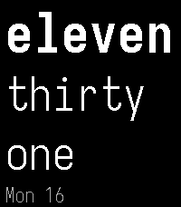

<!-- Generated by scripts/update_app_directory.py: do not edit by hand -->
[← All Pebble Developers](../developers.md)

# Damien

*1 watchface · Last updated 2026-11-23 · [About these lists](../about-app-lists.md)*

Links: [Pebble App Store](https://apps.repebble.com/apps/dev/damien_9e590d1210f686be16f16e63) · [GitHub (damosullivan)](https://github.com/damosullivan)

<h2 class="app-name" id="app-719f27f4b48048d080225d6b"><a href="https://apps.repebble.com/719f27f4b48048d080225d6b">Ten Forty</a> v1.1.1</h2>
<a class="app-source" href="https://github.com/damosullivan/ten-forty" title="Source code" data-search-exclude>View source</a>

Watchface

Other Released 2026-11-13 Updated 2026-11-16

Runs on: Round 2, Time 2, Pebble 2 Duo, Time Round, Time

The time, in three words. Nine. Forty. Two. Set in Iosevka, with the hour in bold and the minutes in light, stacked on a baseline grid that fills the display. No icons, no weather, no step…

