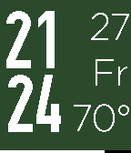
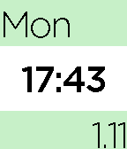
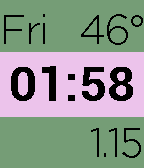
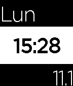
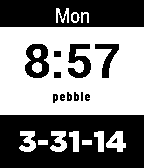

<!-- Generated by scripts/update_app_directory.py: do not edit by hand -->
[← All Pebble Developers](../developers.md)

# Dan Hart

*5 watchfaces · Last updated 2026-10-11 · [About these lists](../about-app-lists.md)*

Links: [Pebble App Store](https://apps.repebble.com/apps/dev/dan-hart_52fec0a4756d34a53a0004b6) · [GitHub (dan-hart)](https://github.com/dan-hart) · [GitHub (mizzoudan)](https://github.com/mizzoudan) · [Website (danhart.me)](http://danhart.me/)

<button type="button" data-filter="all" aria-pressed="true">All 5</button><button type="button" data-filter="watchface" aria-pressed="false">Watchfaces 5</button><button type="button" data-filter="watchapp" aria-pressed="false" disabled>Apps 0</button>

<label class="dev-sort">Sort by <select><option value="updated">Recently updated</option><option value="released">Newest release</option><option value="title">A–Z</option></select></label>

<h2 class="app-name" id="app-569f256470f3698e29000024"><a href="https://apps.repebble.com/569f256470f3698e29000024">The Hart</a> v1.9</h2>
<a class="app-source" href="https://github.com/dan-hart/the-hart-pebble-watchface" title="Source code" data-search-exclude>View source</a>

Watchface

Released 2016-01-20 Updated 2017-03-16

Runs on: Time 2, Pebble 2 Duo, Pebble 2, Time, Classic

PERSONAL USE - LOOK AT MY OTHER WATCH FACES FOR CUSTOMIZABILITY

<h2 class="app-name" id="app-544f1ac4dc21b79c2d000014"><a href="https://apps.repebble.com/544f1ac4dc21b79c2d000014">The Modern Gentleman</a> v2.0</h2>
<a class="app-source" href="https://github.com/dan-hart/the-modern-gentleman" title="Source code" data-search-exclude>View source</a>

Watchface

Released 2014-10-28 Updated 2016-10-16

Runs on: Time 2, Pebble 2 Duo, Pebble 2, Time, Classic

TMG is a great low-power consumption option for Pebble Time! The Original MG. ============= Features: - Optimized for battery life. - Sleek, simple design. - Easy-to-read letters and numbers.

<h2 class="app-name" id="app-569c40bbd05afe633b000057"><a href="https://apps.repebble.com/569c40bbd05afe633b000057">The Modern Gentleman 2</a> v1.7</h2>
<a class="app-source" href="https://github.com/dan-hart/the-modern-gentleman-2" title="Source code" data-search-exclude>View source</a>

Watchface

Released 2016-01-18 Updated 2016-09-03

Runs on: Round 2, Time 2, Pebble 2 Duo, Pebble 2, Time Round, Time, Classic

The Modern Gentleman 2 ==================== - Color Customizable! - C or F Weather - MM-DD, DD-MM (with option to add year!) - Language Customizability Available with Spanish Days of the Week!

<h2 class="app-name" id="app-569421164633c80ea8000070"><a href="https://apps.repebble.com/569421164633c80ea8000070">The Modern Gentleman (Spanish)</a> v1.2</h2>
<a class="app-source" href="http://www.github.com/dan-hart/the-modern-gentleman.git" title="Source code" data-search-exclude>View source</a>

Watchface

No licence Released 2016-01-11 Updated 2016-01-11

Runs on: Round 2, Time 2, Pebble 2 Duo, Pebble 2, Time Round, Time, Classic

TMG with a Spanish Twist!

<h2 class="app-name" id="app-533b17d8c45ef2bf6b00029b"><a href="https://apps.repebble.com/533b17d8c45ef2bf6b00029b">Simple Face</a> v1.2.0</h2>
<a class="app-source" href="https://github.com/mizzoudan/SimpleFace1.2-Pebble" title="Source code" data-search-exclude>View source</a>

Watchface

Released 2014-04-01 Updated 2014-04-30

Runs on: Time 2, Pebble 2 Duo, Pebble 2, Time, Classic

SimpleFace - By Dan Hart ==================== - Simple Time ( 24 or 12 ) - Color Invert + Vibe on disconnect. - Day of the Week - Date (MM - DD - YYYY) Heavily based on Futura Weather, big thanks…

