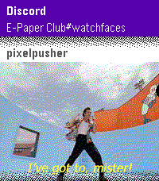

<!-- Generated by scripts/update_app_directory.py: do not edit by hand -->
[← All Pebble Developers](../developers.md)

# dAN-o

*1 app · Last updated 2026-10-12 · [About these lists](../about-app-lists.md)*

Links: [Pebble App Store](https://apps.repebble.com/apps/dev/dan-o_7554f7efe7fa233696d7913a) · [GitHub (killdano)](https://github.com/killdano) · [Website (mirrormap.app)](https://mirrormap.app/mirrormsg)

<h2 class="app-name" id="app-a6afc81d58194fa6969f0c34"><a href="https://apps.repebble.com/a6afc81d58194fa6969f0c34">MirrorMsg</a> v0.94.0</h2>
<a class="app-source" href="https://github.com/killdano/mirrormsg" title="Source code" data-search-exclude>View source</a>

App

Released 2026-07-07 Updated 2026-10-11

Runs on: Time 2, Time

MirrorMsg is the most advanced messaging client for Pebble. Log in to your accounts and see all your live conversations in chat threads that scroll through the entire chat, with rich modern…

