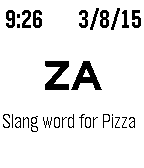

<!-- Generated by scripts/update_app_directory.py: do not edit by hand -->
[← All Pebble Developers](../developers.md)

# Dan Tasse

*2 watchfaces · Last updated 2026-10-11 · [About these lists](../about-app-lists.md)*

Links: [Pebble App Store](https://apps.repebble.com/apps/dev/dan-tasse_531b0c3f6b9bbebb750001e1) · [GitHub (dantasse)](https://github.com/dantasse)

<button type="button" data-filter="all" aria-pressed="true">All 2</button><button type="button" data-filter="watchface" aria-pressed="false">Watchfaces 2</button><button type="button" data-filter="watchapp" aria-pressed="false" disabled>Apps 0</button>

<label class="dev-sort">Sort by <select><option value="updated">Recently updated</option><option value="released">Newest release</option><option value="title">A–Z</option></select></label>

<h2 class="app-name" id="app-54fbc30de62469551c0000ea"><a href="https://apps.repebble.com/54fbc30de62469551c0000ea">Scrabble Two Letters</a> v1.0</h2>
<a class="app-source" href="https://github.com/dantasse/scrabble_two_letters" title="Source code" data-search-exclude>View source</a>

Watchface

Released 2015-03-08 Updated 2015-03-09

Runs on: Time 2, Pebble 2 Duo, Pebble 2, Time, Classic

Shows two-letter words, one per minute, so you can learn them for playing word games. Contains all 105 two-letter words that are legal in the Official Scrabble Dictionary, OSPD5. (For two-letter…

<h2 class="app-name" id="app-54d7bf9c513e9c66e10000b4"><a href="https://apps.repebble.com/54d7bf9c513e9c66e10000b4">Pokemon Watch</a> v1.0</h2>
<a class="app-source" href="https://github.com/dantasse/PokemonWatch" title="Source code" data-search-exclude>View source</a>

Watchface

Released 2015-02-08 Updated 2015-02-08

Runs on: Time 2, Pebble 2 Duo, Pebble 2, Time, Classic

Displays a Pokemon instead of the time. Pokemon 0-59 are shown, one per minute. There&#x27;s no hour hand.

