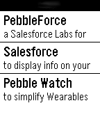
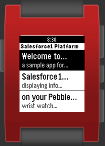

<!-- Generated by scripts/update_app_directory.py: do not edit by hand -->
[← All Pebble Developers](../developers.md)

# DanHca

*2 apps · Last updated 2026-10-12 · [About these lists](../about-app-lists.md)*

Links: [Pebble App Store](https://apps.repebble.com/apps/dev/danhca_530673457f35766a670004cb) · [GitHub (DanHca)](https://github.com/DanHca) · [GitHub (developerforce)](https://github.com/developerforce) · [Website (appexchange.salesforce.com)](https://appexchange.salesforce.com/listingDetail?listingId=a0N3000000B5eUdEAJ)

<button type="button" data-filter="all" aria-pressed="true">All 2</button><button type="button" data-filter="watchface" aria-pressed="false" disabled>Watchfaces 0</button><button type="button" data-filter="watchapp" aria-pressed="false">Apps 2</button>

<label class="dev-sort">Sort by <select><option value="updated">Recently updated</option><option value="released">Newest release</option><option value="title">A–Z</option></select></label>

<h2 class="app-name" id="app-541e31e4c52901a0a300003b"><a href="https://apps.repebble.com/541e31e4c52901a0a300003b">PebbleForce for Salesforce</a> v1.1</h2>
<a class="app-source" href="https://github.com/DanHca/PebbleForce" title="Source code" data-search-exclude>View source</a>

App

No licence Released 2014-09-21 Updated 2014-09-27

Runs on: Time 2, Pebble 2 Duo, Pebble 2, Time, Classic

Display information from Salesforce, post to Chatter, or create a Case using your own menu structure without any code. Used in conjunction with the Salesforce AppExchange component to easily…

<h2 class="app-name" id="app-5395fc78c500b46a5b000010"><a href="https://apps.repebble.com/5395fc78c500b46a5b000010">PebbleForce Dashboard for Salesforce</a> v1.1</h2>
<a class="app-source" href="https://github.com/developerforce/WearablePack-Pebble" title="Source code" data-search-exclude>View source</a>

App

No licence Released 2014-06-09 Updated 2014-06-10

Runs on: Time 2, Pebble 2 Duo, Pebble 2, Time, Classic

Salesforce1 Pebble Dashboard This is an application that can connect to any Salesforce Instance and securely display the totals from your reports on your Pebble using iOS. You simply need to set…

