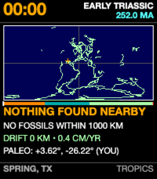
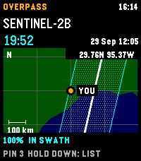

<!-- Generated by scripts/update_app_directory.py: do not edit by hand -->
[← All Pebble Developers](../developers.md)

# Daniel Bally

*2 watchfaces and 2 apps · Last updated 2026-10-12 · [About these lists](../about-app-lists.md)*

Links: [Pebble App Store](https://apps.repebble.com/apps/dev/daniel-bally_e8468a0ff28edd5791d1bced) · [GitHub (globe-and-atlas)](https://github.com/globe-and-atlas)

<button type="button" data-filter="all" aria-pressed="true">All 4</button><button type="button" data-filter="watchface" aria-pressed="false">Watchfaces 2</button><button type="button" data-filter="watchapp" aria-pressed="false">Apps 2</button>

<label class="dev-sort">Sort by <select><option value="updated">Recently updated</option><option value="released">Newest release</option><option value="title">A–Z</option></select></label>

<h2 class="app-name" id="app-490fd055aa9b485c8deced5e"><a href="https://apps.repebble.com/490fd055aa9b485c8deced5e">Pangaea Drift</a> v1.0.1</h2>
<a class="app-source" href="https://github.com/globe-and-atlas/pangaea-watch" title="Source code" data-search-exclude>View source</a>

Watchface

No licence Released 2026-10-03 Updated 2026-10-03

Runs on: Time 2

A deep-time cartographic watchface for Pebble Time 2 (Emery). Midnight is 252 million years ago at the Triassic dawn; 23:59 marks the Cretaceous-Paleogene asteroid impact (66 Ma); and the final 60…

<h2 class="app-name" id="app-6e920a2fa6304e45b4644116"><a href="https://apps.repebble.com/6e920a2fa6304e45b4644116">Satellite Overpass</a> v0.4.0</h2>
<a class="app-source" href="https://github.com/globe-and-atlas/overpass-watch" title="Source code" data-search-exclude>View source</a>

App

No licence Released 2026-09-28 Updated 2026-10-02

Runs on: Time 2

Plan Landsat 8/9 and Sentinel-2A/B/C passes over your location on Pebble Time 2. See a countdown, hourly cloud forecast, and modeled cross-track coverage. A 30-day history reports matching Earth…

<h2 class="app-name" id="app-d9fc15a8f87746b7ba01f6ca"><a href="https://apps.repebble.com/d9fc15a8f87746b7ba01f6ca">From Here</a> v0.2.0</h2>
<a class="app-source" href="https://github.com/globe-and-atlas/from-here" title="Source code" data-search-exclude>View source</a>

Watchface

No licence Released 2026-09-28 Updated 2026-10-02

Runs on: Time 2

Your location is the start. At 10:42 you are 10 degrees 42 minutes away along the direction you chose; the face shows where that is on a map, names the place, and tells you which town comes next…

<h2 class="app-name" id="app-10f46ae849224d009644f7e8"><a href="https://apps.repebble.com/10f46ae849224d009644f7e8">Constellation</a> v0.2.0</h2>
<a class="app-source" href="https://github.com/globe-and-atlas/constellation-watch" title="Source code" data-search-exclude>View source</a>

App

No licence Released 2026-09-28 Updated 2026-10-02

Runs on: Time 2

An educational orbital-geometry watchapp for Pebble Time 2. Constellation propagates public CelesTrak GP/TLE element sets with SGP4 to plot modeled GPS, Galileo, GLONASS, and BeiDou positions. It…

