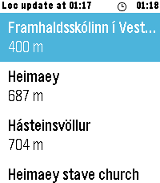

<!-- Generated by scripts/update_app_directory.py: do not edit by hand -->
[← All Pebble Developers](../developers.md)

# Daniel E V

*1 app · Last updated 2026-10-11 · [About these lists](../about-app-lists.md)*

Links: [Pebble App Store](https://apps.repebble.com/apps/dev/daniel-e-v_d047658cc203d3cda0ef09bb) · [GitHub (danieleldjarn)](https://github.com/danieleldjarn)

<h2 class="app-name" id="app-61288080085549ccb302c108"><a href="https://apps.repebble.com/61288080085549ccb302c108">WikiRadar</a> v1.0.4</h2>
<a class="app-source" href="https://github.com/danieleldjarn/WikiRadar" title="Source code" data-search-exclude>View source</a>

App

Released 2026-07-08 Updated 2026-07-10

Runs on: Round 2, Time 2, Pebble 2 Duo, Pebble 2, Time Round, Time, Classic

WikiRadar shows you Wikipedia articles about the places around you. SCAN — a list of nearby articles with distances, refreshed automatically as you move around. READ — full article intros on your…

