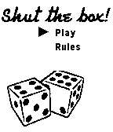

<!-- Generated by scripts/update_app_directory.py: do not edit by hand -->
[← All Pebble Developers](../developers.md)

# Daniel Head

*1 app · Last updated 2026-10-11 · [About these lists](../about-app-lists.md)*

Links: [Pebble App Store](https://apps.repebble.com/apps/dev/daniel-head_52b408c8f637b2bfe7000014) · [GitHub (danhead)](https://github.com/danhead) · [Website (danielhead.com)](http://danielhead.com)

<h2 class="app-name" id="app-52b40d99b06f4b836900001d"><a href="https://apps.repebble.com/52b40d99b06f4b836900001d">Shut the box</a> v1.0.1</h2>
<a class="app-source" href="https://github.com/danhead/ShutTheBox/" title="Source code" data-search-exclude>View source</a>

App

Released 2013-12-20 Updated 2014-02-10

Runs on: Time 2, Pebble 2 Duo, Pebble 2, Time, Classic

Centuries old table top dice game, reimagined for your Pebble Watch!

