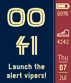
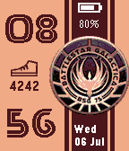

<!-- Generated by scripts/update_app_directory.py: do not edit by hand -->
[← All Pebble Developers](../developers.md)

# Daniel Lima

*3 watchfaces · Last updated 2026-10-12 · [About these lists](../about-app-lists.md)*

Links: [Pebble App Store](https://apps.repebble.com/apps/dev/daniel-lima_56d65637d11364847500004f) · [GitHub (DanielLimaDF)](https://github.com/DanielLimaDF)

<button type="button" data-filter="all" aria-pressed="true">All 3</button><button type="button" data-filter="watchface" aria-pressed="false">Watchfaces 3</button><button type="button" data-filter="watchapp" aria-pressed="false" disabled>Apps 0</button>

<label class="dev-sort">Sort by <select><option value="updated">Recently updated</option><option value="released">Newest release</option><option value="title">A–Z</option></select></label>

<h2 class="app-name" id="app-577ddfc566202a598b0002a4"><a href="https://apps.repebble.com/577ddfc566202a598b0002a4">Battlestar Galactica Quotes</a> v1.0</h2>
<a class="app-source" href="https://github.com/DanielLimaDF/BATTLESTAR_GALACTICA_QUOTES_PEBBLE_FACE" title="Source code" data-search-exclude>View source</a>

Watchface

No licence Released 2016-07-07 Updated 2016-07-07

Runs on: Round 2, Time 2, Pebble 2 Duo, Pebble 2, Time Round, Time, Classic

Battlestar Galactica watchface with quotes that change every minute. Showing current date, day of week, time, steps and battery status. So say we all!

<h2 class="app-name" id="app-577de5476c21044cf50002a9"><a href="https://apps.repebble.com/577de5476c21044cf50002a9">Battlestar Galactica Photos</a> v1.0</h2>
<a class="app-source" href="https://github.com/DanielLimaDF/BATTLESTAR_GALACTICA_PEBBLE_WATCHFACE" title="Source code" data-search-exclude>View source</a>

Watchface

No licence Released 2016-07-07 Updated 2016-07-07

Runs on: Round 2, Time 2, Pebble 2 Duo, Pebble 2, Time Round, Time, Classic

Battlestar Galactica watchface with three different backgrounds that change every 5 minutes. Showing current date, day of week, time, steps and battery status. So say we all!

<h2 class="app-name" id="app-577dd52c66202a598b00029b"><a href="https://apps.repebble.com/577dd52c66202a598b00029b">Battlestar Galactica BSG75</a> v1.0</h2>
<a class="app-source" href="https://github.com/DanielLimaDF/BATTLESTAR_GALACTICA_BSG75_PEBBLE_FACE" title="Source code" data-search-exclude>View source</a>

Watchface

No licence Released 2016-07-07 Updated 2016-07-07

Runs on: Round 2, Time 2, Pebble 2 Duo, Pebble 2, Time Round, Time, Classic

Battlestar Galactica watchface showing current date, day of week, time, steps and battery status. So say we all!

