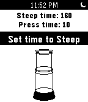

<!-- Generated by scripts/update_app_directory.py: do not edit by hand -->
[← All Pebble Developers](../developers.md)

# Daniel Tse

*1 app · Last updated 2026-10-12 · [About these lists](../about-app-lists.md)*

Links: [Pebble App Store](https://apps.repebble.com/apps/dev/daniel-tse_52d0bf4d336477716e0000a9) · [GitHub (jogloran)](https://github.com/jogloran) · [Website (reddit.com)](http://www.reddit.com/r/pebble/comments/1cgzo2/bawrista_like_plungeraeropress_coffee_have_a/)

<h2 class="app-name" id="app-52ef9118c503c88ecb00003f"><a href="https://apps.repebble.com/52ef9118c503c88ecb00003f">baWrista</a> v1.0.0</h2>
<a class="app-source" href="http://github.com/jogloran/bawrista2" title="Source code" data-search-exclude>View source</a>

App

No licence Released 2014-02-03 Updated 2014-02-03

Runs on: Time 2, Pebble 2 Duo, Pebble 2, Time, Classic

A timer for French press, Aeropress and plunger coffee, with animated Aeropress! Set steep time and press time with the up and down buttons, then confirm each with the select button. The Pebble&#x27;s…

