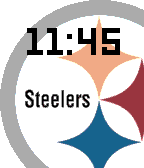

<!-- Generated by scripts/update_app_directory.py: do not edit by hand -->
[← All Pebble Developers](../developers.md)

# Daniel Watkins

*1 watchface · Last updated 2026-10-11 · [About these lists](../about-app-lists.md)*

Links: [Pebble App Store](https://apps.repebble.com/apps/dev/daniel-watkins_5564cc765818e001230000b4) · [GitHub (OddBloke)](https://github.com/OddBloke)

<h2 class="app-name" id="app-56e426c6da71e3ffb9000006"><a href="https://apps.repebble.com/56e426c6da71e3ffb9000006">Pittsburgh Steelers</a> v3.3</h2>
<a class="app-source" href="https://github.com/OddBloke/steelers-pebble-face" title="Source code" data-search-exclude>View source</a>

Watchface

No licence Released 2016-03-12 Updated 2016-03-13

Runs on: Round 2, Time 2, Time Round, Time

Let&#x27;s go Steelers!

