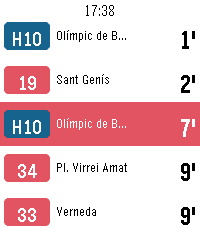

<!-- Generated by scripts/update_app_directory.py: do not edit by hand -->
[← All Pebble Developers](../developers.md)

# danigili

*1 app · Last updated 2026-10-11 · [About these lists](../about-app-lists.md)*

Links: [Pebble App Store](https://apps.repebble.com/apps/dev/unknown_1d0816face36d1d60e4c110d) · [GitHub (danigili)](https://github.com/danigili)

<h2 class="app-name" id="app-879a5ce7d61b4cf49bf775e5"><a href="https://apps.repebble.com/879a5ce7d61b4cf49bf775e5">BCN Bus - live Barcelona bus times</a> v1.0.0</h2>
<a class="app-source" href="https://github.com/danigili/pebble-bcn-bus" title="Source code" data-search-exclude>View source</a>

App

Released 2026-09-16 Updated 2026-09-16

Runs on: Round 2, Time 2, Pebble 2 Duo, Pebble 2, Time Round, Time

Real-time bus arrivals for Barcelona on your Pebble. See how long until the next bus at any TMB stop without taking your phone out. Favourites— keep the stops you use every day and open them in…

