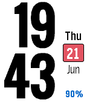

<!-- Generated by scripts/update_app_directory.py: do not edit by hand -->
[← All Pebble Developers](../developers.md)

# Dark

*1 watchface · Last updated 2026-10-12 · [About these lists](../about-app-lists.md)*

Links: [Rebble App Store](https://apps.rebble.io/en_US/developer/56003ed5d3ea40832d00006d/1) · [GitHub (lukefor)](https://github.com/lukefor)

<h2 class="app-name" id="app-5b2bf021fbaf9ae33400044d"><a href="https://apps.rebble.io/en_US/application/5b2bf021fbaf9ae33400044d">watsface</a> v1.1</h2>
<a class="app-source" href="https://github.com/lukefor/watsface" title="Source code" data-search-exclude>View source</a>

Watchface

Released 2018-06-21 Updated 2021-11-21 Rebble App Store

Runs on: Time 2, Time

Works as is shown in the screenshots, with no configuration. Font is Oswald from Google Fonts. Displays charging status, vibrates on disconnect, all that good stuff. Developed with battery life as…

