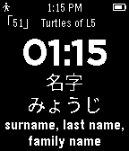

<!-- Generated by scripts/update_app_directory.py: do not edit by hand -->
[← All Pebble Developers](../developers.md)

# Darkenvy

*1 watchface · Last updated 2026-10-11 · [About these lists](../about-app-lists.md)*

Links: [Pebble App Store](https://apps.repebble.com/apps/dev/darkenvy_554ba2255fa04f8b99000056) · [GitHub (darkenvy)](https://github.com/darkenvy) · [Website (renomckenzie.com)](http://renomckenzie.com/)

<h2 class="app-name" id="app-5765fc4d0cc8f55521000149"><a href="https://apps.repebble.com/5765fc4d0cc8f55521000149">WaniKani TokeiTokei</a> v3.5</h2>
<a class="app-source" href="https://github.com/darkenvy/TokeiTokei/" title="Source code" data-search-exclude>View source</a>

Watchface

Released 2016-06-19 Updated 2016-06-19

Runs on: Round 2, Time 2, Pebble 2 Duo, Pebble 2, Time Round, Time, Classic

NOTE: Must install this Japanese language pack to work! Japanese is not natively supported by Pebble. http://wh.to/pebble/index_jp.html WaniKani on your Pebble watch! Immerse yourself not only…

