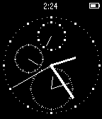
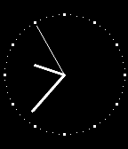
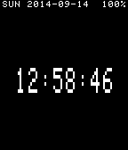
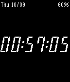
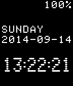

<!-- Generated by scripts/update_app_directory.py: do not edit by hand -->
[← All Pebble Developers](../developers.md)

# Darren Embry

*4 watchfaces and 1 app · Last updated 2026-10-11 · [About these lists](../about-app-lists.md)*

Links: [Pebble App Store](https://apps.repebble.com/apps/dev/darren-embry_53fe39bc95b19192710000d4) · [GitHub (dse)](https://github.com/dse)

<button type="button" data-filter="all" aria-pressed="true">All 5</button><button type="button" data-filter="watchface" aria-pressed="false">Watchfaces 4</button><button type="button" data-filter="watchapp" aria-pressed="false">Apps 1</button>

<label class="dev-sort">Sort by <select><option value="updated">Recently updated</option><option value="released">Newest release</option><option value="title">A–Z</option></select></label>

<h2 class="app-name" id="app-5535ed458a7157a2cb000055"><a href="https://apps.repebble.com/5535ed458a7157a2cb000055">Pilot Watch</a> v1.0</h2>
<a class="app-source" href="https://github.com/dse/watchapp-pilot-watch" title="Source code" data-search-exclude>View source</a>

App

Released 2015-04-21 Updated 2018-03-11

Runs on: Time 2, Pebble 2 Duo, Pebble 2, Time, Classic

An analog watchface app. UP button starts/stops. DOWN button resets.

<h2 class="app-name" id="app-55496dbfd6f29a29b2000104"><a href="https://apps.repebble.com/55496dbfd6f29a29b2000104">Dress Watch</a> v2.0</h2>
<a class="app-source" href="https://github.com/dse/watchface-dress-watch" title="Source code" data-search-exclude>View source</a>

Watchface

Released 2015-05-06 Updated 2018-03-11

Runs on: Time 2, Pebble 2 Duo, Pebble 2, Time, Classic

A clean classic analog watchface. Based on my watchapp, Pilot Watch.

<h2 class="app-name" id="app-5415d01196fc8005b200018d"><a href="https://apps.repebble.com/5415d01196fc8005b200018d">Dot Matrix Watchface #2</a> v1.1</h2>
<a class="app-source" href="https://github.com/dse/watchface-dot-matrix-2" title="Source code" data-search-exclude>View source</a>

Watchface

Released 2014-09-14 Updated 2014-11-02

Runs on: Time 2, Pebble 2 Duo, Pebble 2, Time, Classic

A different take on my Dot Matrix Watchface concept. Date and battery level are always visible but tiny. You can switch to a larger clock font with a cool phosphor effect, and can switch between…

<h2 class="app-name" id="app-543615e8705eaaed670001f6"><a href="https://apps.repebble.com/543615e8705eaaed670001f6">7-Segment #1</a> v1.1</h2>
<a class="app-source" href="https://github.com/dse/watchface-7-segment-1" title="Source code" data-search-exclude>View source</a>

Watchface

Released 2014-10-09 Updated 2014-10-09

Runs on: Time 2, Pebble 2 Duo, Pebble 2, Time, Classic

It&#x27;s... a seven-segment LCD style watchface. Switch to another watchface and back to this one to switch to inverse video. Repeat to switch back to normal.

<h2 class="app-name" id="app-53ffea0fc7bdc02853000057"><a href="https://apps.repebble.com/53ffea0fc7bdc02853000057">Dot Matrix Watchface #1</a> v1.1</h2>
<a class="app-source" href="https://github.com/dse/watchface-dot-matrix-1" title="Source code" data-search-exclude>View source</a>

Watchface

Released 2014-08-29 Updated 2014-09-14

Runs on: Time 2, Pebble 2 Duo, Pebble 2, Time, Classic

A nice, calm, serene dot matrix watchface that displays all the information you need (date and time) without all the fuss. This is one of the watchfaces that updates every second but that doesn&#x27;t…

