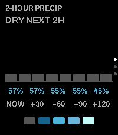
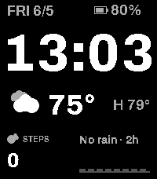

<!-- Generated by scripts/update_app_directory.py: do not edit by hand -->
[← All Pebble Developers](../developers.md)

# Dave Bortz

*1 watchface and 1 app · Last updated 2026-10-12 · [About these lists](../about-app-lists.md)*

Links: [Pebble App Store](https://apps.repebble.com/apps/dev/dave-bortz_a5ed2ca64fa47426fc50360e) · [GitHub (dbortz)](https://github.com/dbortz)

<button type="button" data-filter="all" aria-pressed="true">All 2</button><button type="button" data-filter="watchface" aria-pressed="false">Watchfaces 1</button><button type="button" data-filter="watchapp" aria-pressed="false">Apps 1</button>

<label class="dev-sort">Sort by <select><option value="updated">Recently updated</option><option value="released">Newest release</option><option value="title">A–Z</option></select></label>

<h2 class="app-name" id="app-255715276bde48f1bcf59a80"><a href="https://apps.repebble.com/255715276bde48f1bcf59a80">PebbleSky Detail</a> v1.2.0</h2>
<a class="app-source" href="https://github.com/dbortz/PebbleSky" title="Source code" data-search-exclude>View source</a>

App

MIT Released 2026-06-05 Updated 2026-06-09

Runs on: Time 2

Companion for the PebbleSky watchface: 2-hour precipitation detail, 5-day forecast, and current conditions.

<h2 class="app-name" id="app-66ca3d63cb8a471b888d776b"><a href="https://apps.repebble.com/66ca3d63cb8a471b888d776b">PebbleSky</a> v1.1.0</h2>
<a class="app-source" href="https://github.com/dbortz/PebbleSky" title="Source code" data-search-exclude>View source</a>

Watchface

MIT Released 2026-06-05 Updated 2026-06-05

Runs on: Time 2

A weather watchface with a hyperlocal 2-hour precipitation nowcast and a live rain countdown.

