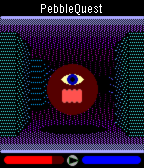
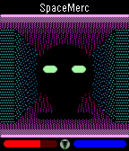
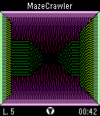

<!-- Generated by scripts/update_app_directory.py: do not edit by hand -->
[← All Pebble Developers](../developers.md)

# David C. Drake

*3 apps · Last updated 2026-10-12 · [About these lists](../about-app-lists.md)*

Links: [Pebble App Store](https://apps.repebble.com/apps/dev/david-c-drake_52a967dbc0ca9380d8000046) · [GitHub (theDrake)](https://github.com/theDrake) · [Website (davidcdrake.com)](http://davidcdrake.com/pebblequest/)

<button type="button" data-filter="all" aria-pressed="true">All 3</button><button type="button" data-filter="watchface" aria-pressed="false" disabled>Watchfaces 0</button><button type="button" data-filter="watchapp" aria-pressed="false">Apps 3</button>

<label class="dev-sort">Sort by <select><option value="updated">Recently updated</option><option value="released">Newest release</option><option value="title">A–Z</option></select></label>

<h2 class="app-name" id="app-52d6a7307b4f9ad65300000c"><a href="https://apps.repebble.com/52d6a7307b4f9ad65300000c">PebbleQuest</a> v1.4</h2>
<a class="app-source" href="https://github.com/theDrake/pebblequest" title="Source code" data-search-exclude>View source</a>

App

Released 2014-01-15 Updated 2016-01-18

Runs on: Time 2, Time

A 3D fantasy action-RPG! Explore dungeons, slay monsters, level up, and wield Pebbles of Power to cast spells or enchant your weapons and armor. How long will you last in the dark, cavernous…

<h2 class="app-name" id="app-52d6a8c0333d76e3d000000a"><a href="https://apps.repebble.com/52d6a8c0333d76e3d000000a">SpaceMerc</a> v1.9</h2>
<a class="app-source" href="https://github.com/theDrake/spacemerc" title="Source code" data-search-exclude>View source</a>

App

Released 2014-01-15 Updated 2016-01-14

Runs on: Time 2, Pebble 2 Duo, Pebble 2, Time, Classic

A 3D first-person shooter (FPS game)! Defend humanity against hostile aliens, earn money, and buy upgrades as you progress through this intense sci-fi action thriller. UP: Press once to step…

<h2 class="app-name" id="app-52a97439c0ca9349a0000051"><a href="https://apps.repebble.com/52a97439c0ca9349a0000051">MazeCrawler</a> v1.9</h2>
<a class="app-source" href="https://github.com/theDrake/mazecrawler" title="Source code" data-search-exclude>View source</a>

App

Released 2013-12-12 Updated 2016-01-14

Runs on: Time 2, Pebble 2 Duo, Pebble 2, Time, Classic

A 3D first-person maze-navigation game and the foundation for SpaceMerc and PebbleQuest. Search each maze for its exit, marked by a hole in the ground, to earn points and unlock up to 12…

