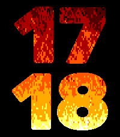

<!-- Generated by scripts/update_app_directory.py: do not edit by hand -->
[← All Pebble Developers](../developers.md)

# David Graus

*1 watchface · Last updated 2026-11-09 · [About these lists](../about-app-lists.md)*

Links: [Pebble App Store](https://apps.repebble.com/apps/dev/david-graus_68ed6354b01aabbc38c26337) · [GitHub (graus)](https://github.com/graus) · [Website (graus.nu)](https://graus.nu/blog/pebble-watch-face-hearth/)

<h2 class="app-name" id="app-6fded59c1f6041be8b87d7b7"><a href="https://apps.repebble.com/6fded59c1f6041be8b87d7b7">Hearth</a> v1.0.0</h2>
<a class="app-source" href="https://github.com/graus/hearth-pebble-watchface" title="Source code" data-search-exclude>View source</a>

Watchface

MIT Released 2026-11-07 Updated 2026-11-07

Runs on: Round 2, Time 2, Pebble 2 Duo, Pebble 2, Time Round, Time, Classic

The time in four large digits, each one a window onto a live fire. Hearth is inspired by Fireplace and draws its flames with the classic PSX Doom fire, computed live on your watch. The Doom fire…

