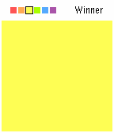

<!-- Generated by scripts/update_app_directory.py: do not edit by hand -->
[← All Pebble Developers](../developers.md)

# David Inglis

*1 app · Last updated 2026-10-11 · [About these lists](../about-app-lists.md)*

Links: [Pebble App Store](https://apps.repebble.com/apps/dev/david-inglis_55b155f7d534109a520000a9) · [GitHub (dainglis)](https://github.com/dainglis)

<h2 class="app-name" id="app-564c2acda9379f613e000044"><a href="https://apps.repebble.com/564c2acda9379f613e000044">Flood</a> v1.0</h2>
<a class="app-source" href="https://github.com/dainglis/flood-pebble-time" title="Source code" data-search-exclude>View source</a>

App

Released 2015-11-18 Updated 2016-04-12

Runs on: Time 2, Time

Fill the board in as few moves as possible. Use the up and down buttons to change colors, and use select to pick. You have 26 moves to fill the board, or else it&#x27;s game over!

