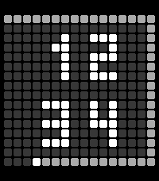

<!-- Generated by scripts/update_app_directory.py: do not edit by hand -->
[← All Pebble Developers](../developers.md)

# David Larose

*1 watchface · Last updated 2026-10-11 · [About these lists](../about-app-lists.md)*

Links: [Pebble App Store](https://apps.repebble.com/apps/dev/david-larose_e1c274d2585a48d6f86a6e56) · [GitHub (9tf48t8hyx-hash)](https://github.com/9tf48t8hyx-hash)

<h2 class="app-name" id="app-7b37290a7c6a4308a63fd59c"><a href="https://apps.repebble.com/7b37290a7c6a4308a63fd59c">PixelTid Dark</a> v1.0.0</h2>
<a class="app-source" href="https://github.com/9tf48t8hyx-hash/pebble-watchfaces" title="Source code" data-search-exclude>View source</a>

Watchface

No licence Released 2026-03-11 Updated 2026-03-11

Runs on: Round 2, Time 2, Pebble 2 Duo, Pebble 2, Time Round, Time, Classic

IKEA OBEGRANSAD LED clock on your wrist. 16x16 pixel matrix with chenillard border animation tracing seconds. Bitmap digits from a real ESP32 IKEA LED panel project. Minimalist, hypnotic, Swedish.

