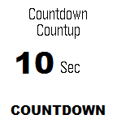
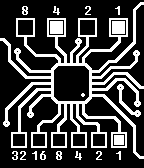

<!-- Generated by scripts/update_app_directory.py: do not edit by hand -->
[← All Pebble Developers](../developers.md)

# David Lenk

*2 watchfaces and 1 app · Last updated 2026-10-11 · [About these lists](../about-app-lists.md)*

Links: [Pebble App Store](https://apps.repebble.com/apps/dev/david-lenk_550c6a346caaed82dd000013) · [GitHub (littleprojects)](https://github.com/littleprojects) · [Website (opensprinkler.com)](https://opensprinkler.com)

<button type="button" data-filter="all" aria-pressed="true">All 3</button><button type="button" data-filter="watchface" aria-pressed="false">Watchfaces 2</button><button type="button" data-filter="watchapp" aria-pressed="false">Apps 1</button>

<label class="dev-sort">Sort by <select><option value="updated">Recently updated</option><option value="released">Newest release</option><option value="title">A–Z</option></select></label>

<h2 class="app-name" id="app-5526ae9ba586f2c62d000043"><a href="https://apps.repebble.com/5526ae9ba586f2c62d000043">COUNTDOWN</a> v2.1</h2>
<a class="app-source" href="https://github.com/littleprojects/Pebble_Countdown" title="Source code" data-search-exclude>View source</a>

Watchface

Released 2015-04-09 Updated 2025-11-25

Runs on: Time 2, Pebble 2 Duo, Pebble 2, Time, Classic

the COUNTDOWN watchface for you Pebble can count DOWN or count UP to a date you want. Setup the date, time and a text of your Event. Never miss a Event, Birthday, deadline or party. Features: …

<h2 class="app-name" id="app-551416cd863098b4430000a3"><a href="https://apps.repebble.com/551416cd863098b4430000a3">binary circuit</a> v2.22</h2>
<a class="app-source" href="https://github.com/littleprojects/Pebble_Circuit_Binary" title="Source code" data-search-exclude>View source</a>

Watchface

Released 2015-03-26 Updated 2025-11-25

Runs on: Time 2, Pebble 2 Duo, Pebble 2, Time, Classic

A simple, easy binary watchface in a circuit design. - binary time - 12 or 24 hour timeformat - show/hide the numbers - day/night (black/white, invert) - auto day/night switching - show BT…

<h2 class="app-name" id="app-55b3b8e4ecb919cccb000062"><a href="https://apps.repebble.com/55b3b8e4ecb919cccb000062">OpenSprinkler</a> v1.32</h2>
<a class="app-source" href="https://github.com/littleprojects/Pebble_Opensprinkler" title="Source code" data-search-exclude>View source</a>

App

Released 2015-07-25 Updated 2016-11-18

Runs on: Time 2, Pebble 2 Duo, Pebble 2, Time, Classic

A Remote for your OpenSprinkler on your watch! - show the sprinkler status and Infos - set rain delay - reset rain delay - manual Mode - stop all stations - start test or programs - update with…

